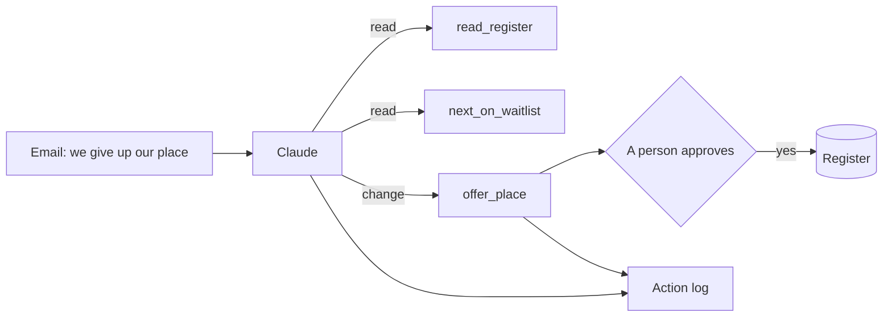

# Let it act safely

## The problem

A family gives up its place. The waiting list must move, the next child gets an offer, and a letter goes out. An
AI can do the steps. But only a person may offer a place, and the list has a planted mistake.

Qonto, a business bank, says its AI agents make transfers "2X faster". It also says: "Any action with a financial
or customer relationship impact requires user confirmation"
([Qonto's story on claude.com](https://claude.com/customers/qonto)). That is the shape here: the AI acts, a person
says yes.

| Step | Minutes | What you hand in | What the check reads |
|---|---|---|---|
| be-the-tool | 10 | `tool-calls.md` | each tool call in order, the right next child, where you would stop it |
| run-the-waitlist-agent | 15 | `action-log.jsonl` and `register.json` | the right withdrawal and offer, a name on every change, the list in policy order |
| stop-the-wrong-action | 10 | `action-log.jsonl` and `stopped.md` | no change for the fake email, and why it stopped |
| map-the-actions (go further) | 10 | `tools.md` | every action, its risk, and who approves it |

## Walkthrough

TODO(part session): one `bun run verify` command per step, each with its Expect: line.
