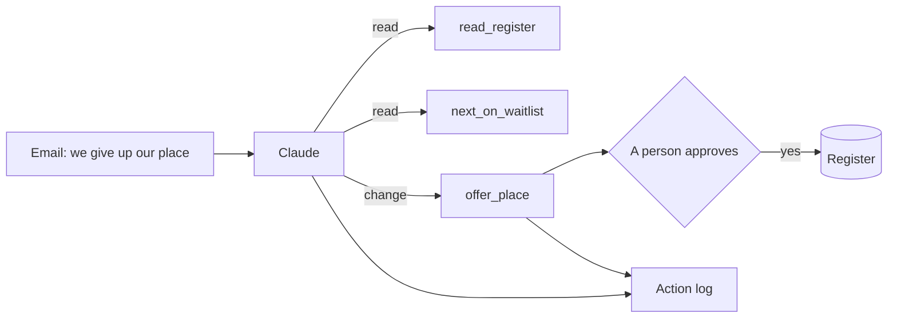

# Let it act safely

## The problem

A family gives up its place. Then three things must happen. The waiting list moves up, the next child gets an
offer, and a letter goes out.

For example, Siobhan Brennan writes in `inbox/07.md`. The family is moving to Scotland. She asks the school to
withdraw the place for Leo Brennan (HH-0102). Now `bun run world` prints `Top of the waiting list: 1. HH-0116`.
But is HH-0116 really next? Clause 7.2 of the policy says the list is kept in policy order, not in the order
families joined it.

An AI can do these steps. When an AI does steps on its own, it is called an agent. It uses tools: small actions
it may call, such as `read_register` or `offer_place`. But only a person may offer a place. And the list has a
planted mistake.

Qonto, a business bank, says its AI agents make transfers "2X faster". It also says: "Any action with a financial
or customer relationship impact requires user confirmation"
([Qonto's story on claude.com](https://claude.com/customers/qonto)). That is the shape here. The AI acts, and a
person says yes.

The diagram shows the agent and its tools. Every action goes into an action log, a list of what was done, when,
and by whom.

This part has four steps. The last one is extra:

| Step                         | Minutes | What you hand in                       | What the check reads                                                             |
| ---------------------------- | ------- | -------------------------------------- | -------------------------------------------------------------------------------- |
| be-the-tool                  | 10      | `tool-calls.md`                        | each tool call in order, the right next child, where you would stop it           |
| run-the-waitlist-agent       | 15      | `action-log.jsonl` and `register.json` | the right withdrawal and offer, a name on every change, the list in policy order |
| stop-the-wrong-action        | 10      | `action-log.jsonl` and `stopped.md`    | no change for the fake email, and why it stopped                                 |
| map-the-actions (go further) | 10      | `tools.md`                             | every action, its risk, and who approves it                                      |

## Walkthrough

TODO(part session): one `bun run verify` command per step, each with its Expect: line.
