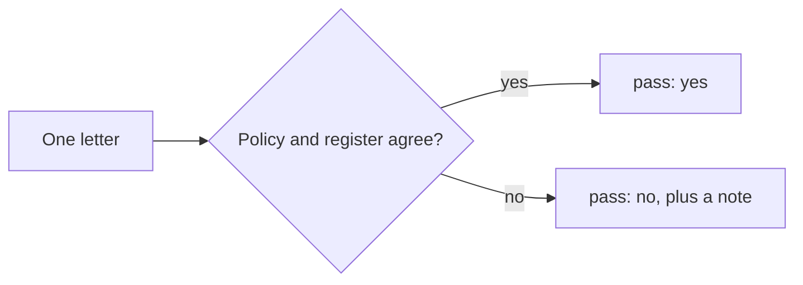
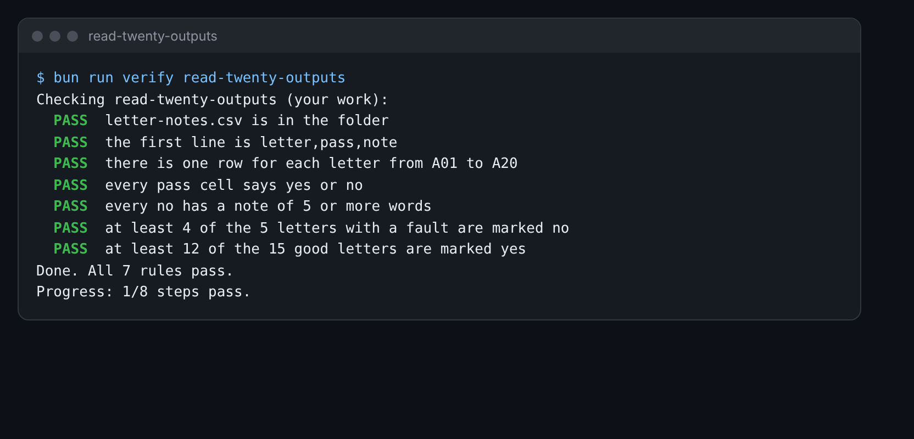

# Read twenty outputs

## The problem

AI drafted 20 letters to families. No person has read them. For example, letter A03 offers Bilal Qureshi a place "under clause 4.6". The policy has no clause 4.6.

The letter looks fine until you check. You cannot fix what you have not seen.



## Watch it done

Before, the starter `letter-notes.csv` has empty cells. The check prints this:

```text
  FAIL  every pass cell says yes or no
  FAIL  at least 4 of the 5 letters with a fault are marked no
  FAIL  at least 12 of the 15 good letters are marked yes
4 of 7 rules pass. Fix the FAIL lines and run it again.
```

After, every row has a yes or no, and every no has a note. The check prints `Done. All 7 rules pass.`



## Your turn

1. Open the letter `world/harbour-hill/letters/batch-a/03.md` and the policy `world/harbour-hill/policy/admissions-policy-2027.md`.
2. Find the clause the letter cites. Look for it in the policy. It is not there.
3. In `letter-notes.csv`, write the row for A03. Row A03 is the letter `03.md`. A `no` needs a note of 5 or more words:

```text
A03,no,Cites clause 4.6 but the policy has no clause 4.6.
```

4. Do the same for the other 19 letters. Write `yes` if the letter can go out as it is. For each letter ask:
   - Is the child's name right for that reference number? The register, `world/harbour-hill/register.json`, says who is who.
   - Does the clause it cites exist in the policy?
   - Does the register agree? An offer must go to a child the register says was offered.
   - Does it say a person decides? Under clause 1.2, no computer makes the decision.
   - If the child is on the waiting list, does it say how to appeal?
5. Run the check.

```bash
bun run verify read-twenty-outputs
```

Expect: `Done. All 7 rules pass.`

If "at least 4 of the 5 letters with a fault" fails, check each clause in the policy and each offer in the register. If "every no has a note of 5 or more words" fails, write a short sentence, not one word like "bad". If "at least 12 of the 15 good letters" fails, mark `no` only when you can name the problem. A short letter can be fine.

You may ask Claude to help you read. Paste the policy and one letter, and ask what looks wrong. Then check its answer yourself. You are the one who signs.

## Do it on your work

Take 10 to 20 outputs from an AI task of your own, such as drafts, summaries or replies. Put each in a row with a yes or no and a note on every no. Good looks like this: for every no, a stranger could find the fault from your note alone.

## Done when

- `letter-notes.csv` has the header `letter,pass,note` and 20 rows, A01 to A20.
- Every `pass` cell is `yes` or `no`, and every `no` has a note of 5 or more words.
- At least 4 of the 5 letters with a fault are marked `no`.
- At least 12 of the 15 good letters are marked `yes`.

The check compares your labels with `world/keys/letters-a.csv`. Open that file only when you are done or stuck.

## Solution

The after state is one filled `letter-notes.csv`. See `solution/letter-notes.csv`.
