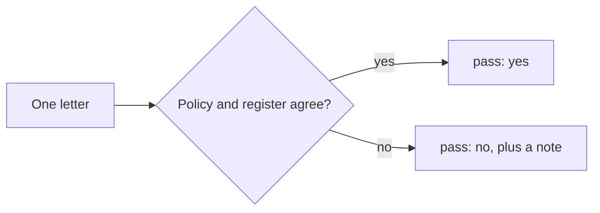
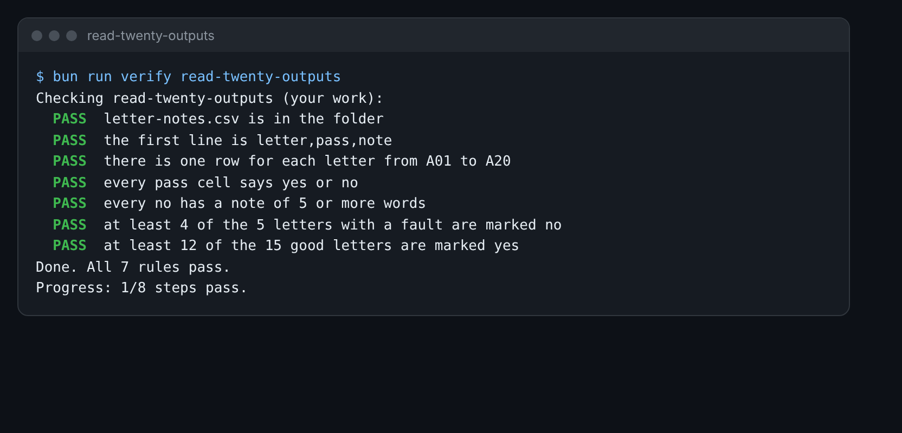

# Read twenty outputs

## The problem

The AI drafted 20 letters to families. They are in `world/harbour-hill/letters/batch-a/`. No person has read them
yet. Some are fine. Some are wrong in a way that hurts a family.

You cannot fix what you have not seen. So the first step is to read. Each letter is an output: what the AI wrote.



## Your challenge

Fill in `letter-notes.csv` in this folder. It has one row for each letter, A01 to A20.

1. Open a letter, for example `world/harbour-hill/letters/batch-a/01.md`.
2. Check it against two things. The policy is `world/harbour-hill/policy/admissions-policy-2027.md`. The register
   is `world/harbour-hill/register.json`. It says where each child stands.
3. In `pass`, write `yes` if the letter can go out as it is. Write `no` if anything is wrong.
4. For each `no`, write a note. Say the first thing wrong, in 5 or more words.

Ask yourself these questions for each letter:

- Is the child's name right for that reference number?
- Does the clause it cites exist in the policy?
- Does the register agree? An offer must go to a child the register says was offered.
- Does it say a person decides? Clause 1.2 says no computer makes the decision.
- If the child is on the waiting list, does it say how to appeal?

For example, letter A03 offers Bilal Qureshi a place under "clause 4.6". The policy has no clause 4.6. So that row
is:

```
A03,no,Cites clause 4.6 but the policy has no clause 4.6.
```

You may ask Claude to help you read. Paste the policy and one letter, and ask what looks wrong. Then check its
answer yourself. You are the one who signs.



## Done when

- `letter-notes.csv` has the header `letter,pass,note` and 20 rows, A01 to A20.
- Every `pass` cell is `yes` or `no`.
- Every `no` has a note of 5 or more words.
- At least 4 of the 5 letters with a fault are marked `no`.
- At least 12 of the 15 good letters are marked `yes`.

How this step is checked: the check compares your labels with the answers in `world/keys/letters-a.csv`. Look at
that file only when you are done or stuck.

```bash
bun run verify read-twenty-outputs
```

Expect: `Done. All 7 rules pass.`

## If you get stuck

| What you see                                    | Fix                                                                       |
| ----------------------------------------------- | ------------------------------------------------------------------------- |
| `FAIL at least 4 of the 5 letters with a fault` | Check each clause in the policy, and each offer in the register.          |
| `FAIL every no has a note of 5 or more words`   | Say what is wrong in a short sentence, not one word like "bad".           |
| `FAIL at least 12 of the 15 good letters`       | Mark `no` only when you can name the problem. A short letter can be fine. |

## Words you will use

- **Output**: what the AI wrote back. Here, one drafted letter.
- **Register**: the school's list of every child and their status. It is the truth the office works from.
- **Label**: your yes or no for one output.
