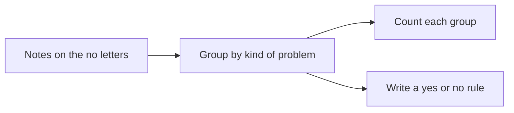
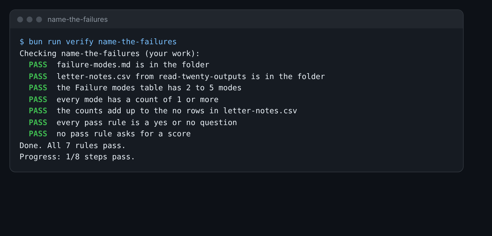

# Name the failures

## The problem

You have notes on 20 letters. "Five letters were bad" does not tell your boss what to fix first.

So you group the notes. Letters with the same kind of problem go in one group. Each group is a failure mode. Then you count each one.



## Watch it done

Before, the starter has no notes beside it and no table. The check prints this:

```text
  FAIL  letter-notes.csv from read-twenty-outputs is in the folder
  FAIL  the Failure modes table has 2 to 5 modes
  FAIL  the counts add up to the no rows in letter-notes.csv
4 of 7 rules pass. Fix the FAIL lines and run it again.
```

After, the table has 2 to 5 modes. Each has a count and a yes or no rule. The check prints `Done. All 7 rules pass.`



## Your turn

1. Copy `letter-notes.csv` from the read-twenty-outputs problem folder into this folder.
2. Read the notes on your `no` rows. Put the same kind of problem together. For example, letter A03 cites a clause that does not exist. That is one failure mode.
3. In `failure-modes.md`, fill in the table. Give each mode a short name and a count. Use 2 to 5 modes. Each `no` letter goes under one mode only.
4. Write one pass rule for each mode. A pass rule is a yes or no question that tells you if one letter is good. Start it with Does, Is, Are or Has. End it with a question mark.

```text
| The clause does not exist | 1 | Does every clause number in the letter exist in the admissions policy? |
```

5. Run the check.

```bash
bun run verify name-the-failures
```

Expect: `Done. All 7 rules pass.`

If "the counts add up to the no rows" fails, count again. If "every pass rule is a yes or no question" fails, check each rule. It starts with Does, Is, Are or Has. It ends with a `?`. If the copy of `letter-notes.csv` is missing, copy it from the last step.

Why yes or no, and not a score from 1 to 5? Give letter A01 a score and ask a friend to do the same. You may say 3 and they may say 4. You are far more likely to agree on yes or no. And a yes or no rule can become a test later.

You may paste your notes into Claude and ask it to suggest groups. Then check that each group makes sense to you.

## Do it on your work

Group the notes on your own outputs from the last step. Good looks like 2 to 5 modes, counts that add up to your `no` rows, and a rule a stranger could answer with no help.

## Done when

- `failure-modes.md` has a Failure modes table with 2 to 5 modes.
- Every mode has a count of 1 or more, and the counts add up to the `no` rows in your `letter-notes.csv`.
- Every pass rule is a yes or no question, and none asks for a score.

The check counts the `no` rows, adds up your counts and reads each rule.

## Solution

The after state is one filled `failure-modes.md`. See `solution/failure-modes.md`.
