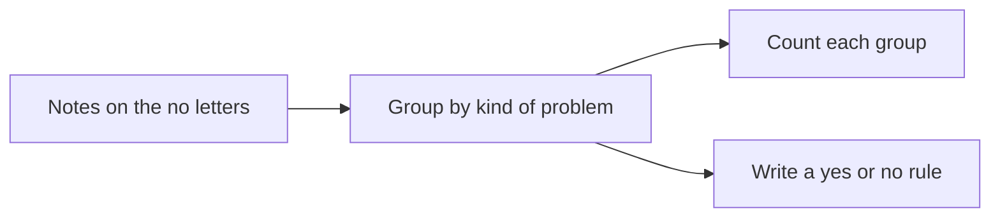
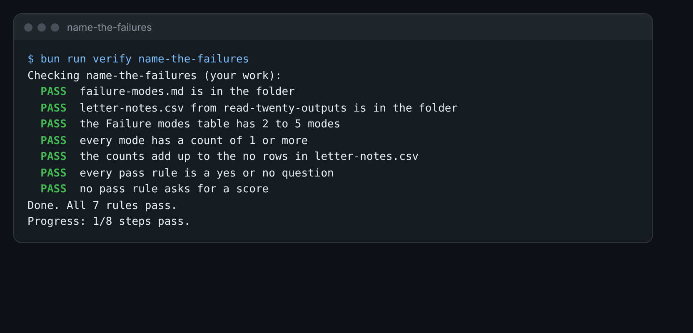

# Name the failures

## The problem

You have notes on 20 letters. A pile of notes does not tell your boss much. "Five letters were bad" does not say
what to fix first.

So you group the notes. Letters with the same kind of problem go in one group. Each group is a failure mode: one
named way the AI goes wrong. Then you count each one. Now you know what to fix first.



## Your challenge

1. Copy your `letter-notes.csv` from the read-twenty-outputs problem folder into this folder.
2. Read the notes on your `no` rows. Put the ones that are the same kind of problem together.
3. Fill in the table in `failure-modes.md`. Give each mode a short name and a count. Use 2 to 5 modes.
4. Write one pass rule for each mode. A pass rule is a question that a stranger can answer with yes or no.

For example, letter A03 cites clause 4.6, which does not exist. One row could be:

```
| The clause does not exist | 1 | Does every clause number in the letter exist in the 2027 policy? |
```

Why yes or no, and not a score from 1 to 5? Two people often give the same letter a 3 and a 4. They far more
often agree on yes or no. And a rule you can answer yes or no can become a test later.

You may paste your notes into Claude and ask it to suggest groups. Then check that each group makes sense to you.



## Done when

- `failure-modes.md` has a Failure modes table with 2 to 5 modes.
- Every mode has a count of 1 or more.
- The counts add up to the `no` rows in your `letter-notes.csv`.
- Every pass rule is a yes or no question, such as "Does ...?" or "Is ...?".
- No pass rule asks for a score.

How this step is checked: the check counts the `no` rows in your `letter-notes.csv`. Then it adds up your counts
and reads each rule.

```bash
bun run verify name-the-failures
```

Expect: `Done. All 7 rules pass.`

## If you get stuck

| What you see                                     | Fix                                                              |
| ------------------------------------------------ | ---------------------------------------------------------------- |
| `FAIL letter-notes.csv from read-twenty-outputs` | Copy the file from the last step's problem folder into this one. |
| `FAIL the counts add up to the no rows`          | Each `no` letter goes under one mode only. Count again.          |
| `FAIL every pass rule is a yes or no question`   | Start the rule with Does, Is, Are or Has, and end it with a `?`. |

## Words you will use

- **Failure mode**: one named way the AI goes wrong, such as "cites a clause that does not exist".
- **Pass rule**: a yes or no question that tells you if one output is good.
- **Count**: how many outputs show that failure mode.
