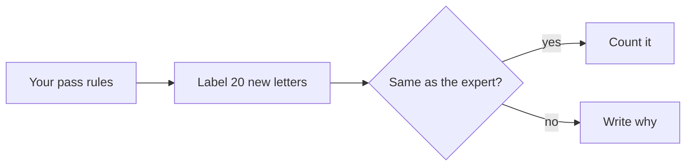
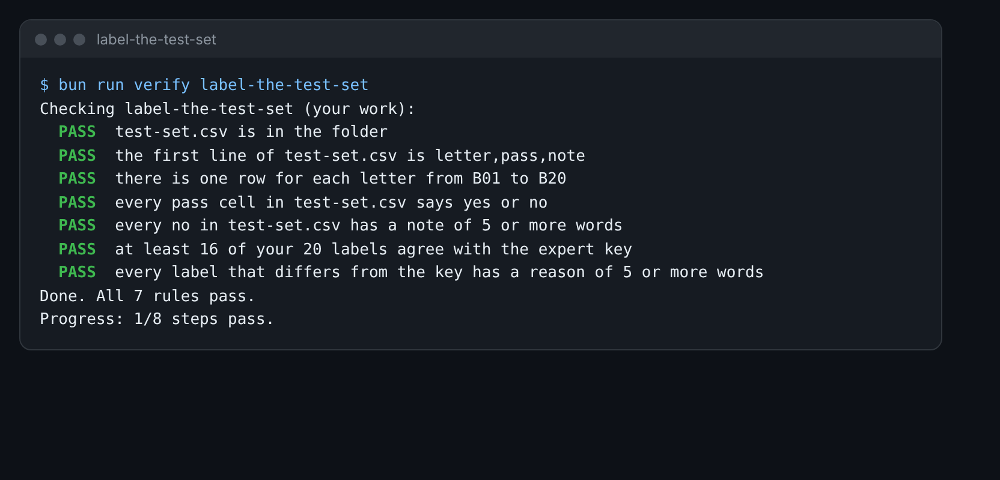

# Label the test set

## The problem

Your pass rules came from batch A. Do they work on letters you have not seen?

A test set is a fixed group of cases where you know the right answer. Batch B has 20 new letters. An expert has labelled them. You label them with your rules, and count how often you agree.



## Watch it done

Before, the starter `test-set.csv` is empty. The check prints this:

```text
  FAIL  every pass cell in test-set.csv says yes or no
  FAIL  at least 16 of your 20 labels agree with the expert key
  FAIL  every label that differs from the key has a reason of 5 or more words
  FAIL  own-test-set.csv has 6 or more different cases from your own work, all filled in
```

After, 16 or more labels agree with the expert. The check prints `Done. All 10 rules pass.`



## Your turn

1. Open your `failure-modes.md` from the last step. Keep your pass rules beside you.
2. For example, open the letter `world/harbour-hill/letters/batch-b/05.md`. Ask each pass rule. If every rule says yes, write `yes`. If one says no, write `no` and a note: which rule failed, and why.

```text
B05,no,Cites clause 4.6 but the policy has no clause 4.6.
```

3. Do the same for B01 to B20 in `test-set.csv`. Row B01 is the letter `01.md`. If a letter breaks no rule but is still wrong, mark it `no`, and add a new rule to `failure-modes.md`.
4. Run the check. It tells you how many labels agree with the expert.

```bash
bun run verify label-the-test-set
```

Expect: `Done. All 10 rules pass.`

5. Open `world/keys/letters-b.csv`. For each letter where you differ, write in `note` why you chose your label. If "there is one row for each letter from B01" fails, use the letters in `batch-b`. If "at least 16 of your 20 labels agree" fails, check names, status and waiting list places in the register.

## Do it on your work

In `own-test-set.csv`, add six real cases from a task in your `about-me.md`. Write the right answer before you ask the AI. Then paste what it gave, and mark `yes` or `no`. A good answer has six different cases, and a reason on every `no`.

## Done when

- `test-set.csv` has the header `letter,pass,note` and 20 rows, B01 to B20.
- Every `pass` cell is `yes` or `no`, and every `no` has a note of 5 or more words.
- At least 16 of your 20 labels agree with the expert key. The bar is 16, because two careful people do not always agree.
- Every label that differs from the key has a reason of 5 or more words.
- `own-test-set.csv` has six or more cases from your own task, and each `no` says why.

## Solution

The finished state is two filled files. See `solution/test-set.csv` and `solution/own-test-set.csv`.
