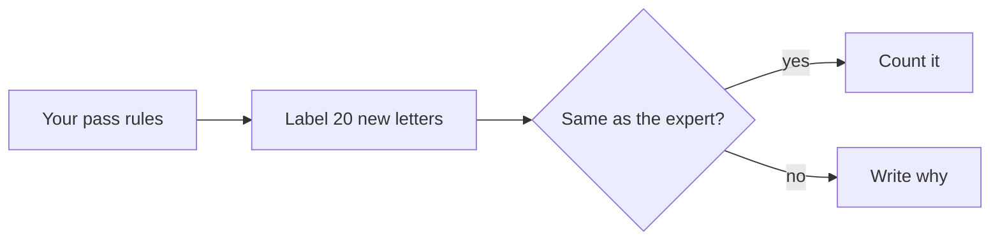
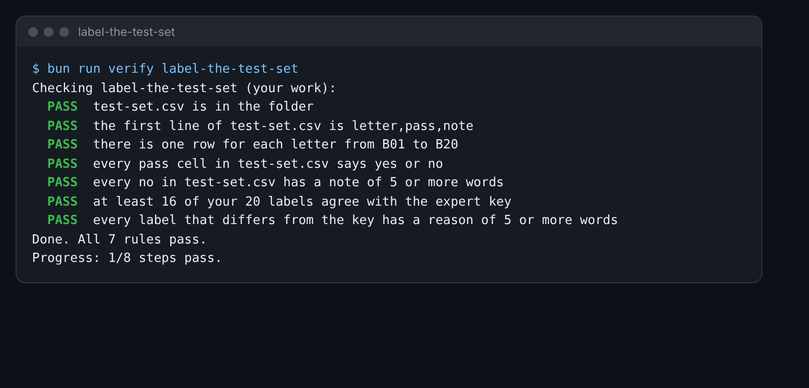

# Label the test set

## The problem

Your pass rules came from batch A. Do they work on letters you have not seen? You find out with a test set. A test
set is a fixed group of cases where you know the right answer. You keep it, and you test the AI on it again after
every change.

Batch B has 20 new letters, in `world/harbour-hill/letters/batch-b/`. An expert has already labelled them. Now you
label them with your rules, and you see how often you agree with the expert.



## Your challenge

Fill in `test-set.csv` in this folder. It has one row for each letter, B01 to B20.

1. Open your `failure-modes.md` from the last step. Keep your pass rules beside you.
2. For each letter, ask each pass rule. If every rule says yes, write `yes`. If one says no, write `no`.
3. For each `no`, write a note: which rule failed, and why.
4. When all 20 are done, run the check. It tells you how many labels agree with the expert.
5. Open `world/keys/letters-b.csv`. For each letter where you disagree, write in `note` why you chose your label.

For example, letter B05 cites clause 4.6. Your rule "Does every clause number exist in the 2027 policy?" says no.
So the row is:

```
B05,no,Cites clause 4.6 but the policy has no clause 4.6.
```

Watch out: a new batch can hold a new kind of fault. If a letter breaks no rule but is still wrong, mark it `no`.
Then add a new mode and a new rule to `failure-modes.md`.



## Done when

- `test-set.csv` has the header `letter,pass,note` and 20 rows, B01 to B20.
- Every `pass` cell is `yes` or `no`, and every `no` has a note of 5 or more words.
- At least 16 of your 20 labels agree with the expert key.
- Every label that differs from the key has a reason of 5 or more words.

How this step is checked: the check compares each label with `world/keys/letters-b.csv`. The bar is 16 of 20, not
20 of 20. Labels are a judgment, and two careful people do not always agree.

```bash
bun run verify label-the-test-set
```

Expect: `Done. All 7 rules pass.`

## If you get stuck

| What you see                                       | Fix                                                                       |
| -------------------------------------------------- | ------------------------------------------------------------------------- |
| `FAIL there is one row for each letter from B01`   | Use the letters in `batch-b`, named B01 to B20.                           |
| `FAIL at least 16 of your 20 labels agree`         | Check names, status and waiting list positions in the register.           |
| `FAIL every label that differs from the key has a` | Open the key, find each letter where you differ, and write why in `note`. |

## Words you will use

- **Test set**: a fixed group of cases with known right answers. You test the AI on it again and again.
- **Agreement**: how many of your labels match the expert's, for example 19 of 20.
- **Expert key**: the answers a careful person wrote first. Here, `world/keys/letters-b.csv`.
