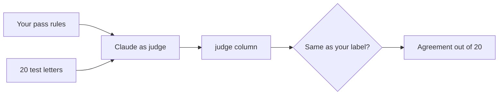
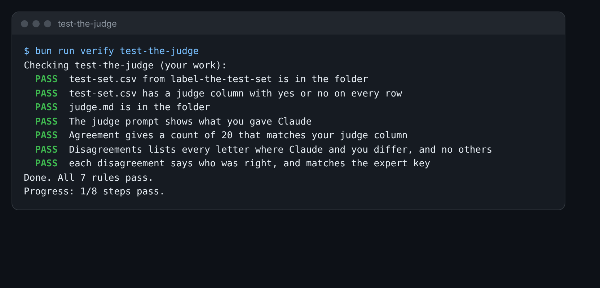

# Test the judge

This step is extra. Do it if you have time.

## The problem

A season has 1,200 letters. You cannot read them all. Could Claude label them with your pass rules?

An AI that labels another AI's work is a judge. You test it first. Give it the 20 letters you labelled and count how often it agrees with you.



## Watch it done

Before, the starter has no judge column. The check prints this:

```text
  FAIL  test-set.csv from label-the-test-set is in the folder
  FAIL  test-set.csv has a judge column with yes or no on every row
  FAIL  The judge prompt shows what you gave Claude
  FAIL  Agreement gives a count of 20 that matches your judge column
```

After, the check prints `Done. All 7 rules pass.`



## Your turn

1. Copy `test-set.csv` from the label-the-test-set problem folder into this folder.
2. Open Claude. Give it the policy and your pass rules from `failure-modes.md`. Paste the letter `world/harbour-hill/letters/batch-b/16.md`. Ask it to answer each rule yes or no, then give one word: yes or no.
3. Add `,judge` to the first line of `test-set.csv`. Add Claude's word to the end of each row. For example, you marked B16 `no`. Claude said `yes`:

```text
B16,no,Offers Ines a place but the register has her on the waiting list.,yes
```

4. Do the same for all 20 letters. Also give Claude the register, `world/harbour-hill/register.json`, for the status rules.
5. Fill in `judge.md`: what you gave Claude, the agreement, and every letter where you differ. In the Disagreements table, write who was right, Me or Claude. Check `world/keys/letters-b.csv` first.
6. Run the check.

```bash
bun run verify test-the-judge
```

Expect: `Done. All 7 rules pass.`

If "test-set.csv has a judge column" fails, the first line must end with `,judge` and each row with yes or no. If "Agreement gives a count of 20" fails, count the rows where pass and judge match. If "each disagreement says who was right" fails, start the cell with Me or Claude.

## Do it on your work

Run the same test on your own six cases from the last step. Good looks like a judge that beats a lazy one. A judge that says yes to every letter already gets 14 of 20 in batch B, so 14 is the bar to beat.

## Done when

- `test-set.csv` has a `judge` column with yes or no on every row.
- `judge.md` shows the prompt you gave Claude under The judge prompt.
- Agreement gives a count out of 20 that matches your judge column.
- Disagreements lists every letter where you and Claude differ, and no others.
- Each disagreement says who was right, and the expert key agrees.

The check reads your two files and the key. It never reads Claude's chat.

## Solution

The after state is a `judge` column and a filled `judge.md`. See `solution/judge.md` and `solution/test-set.csv`.
