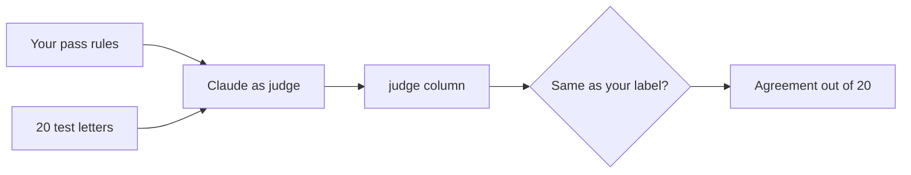
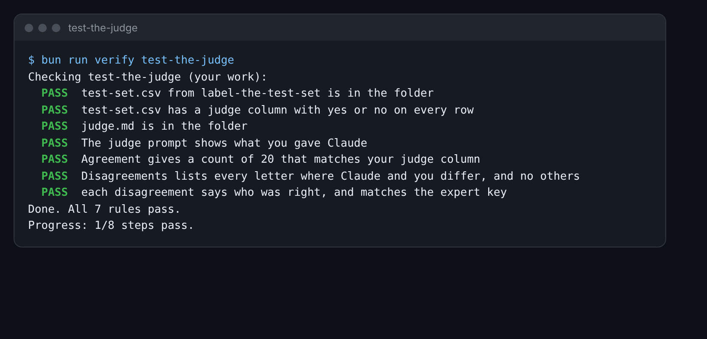

# Test the judge

This step is extra. Do it if you have time.

## The problem

You labelled 20 letters by hand. A season has 1,200. You cannot read them all. Could Claude label them for you,
with your pass rules? When an AI labels the work of an AI, it is called a judge.

A judge is only useful if it agrees with a careful person. So before you trust it, you test it. You give it the
same 20 letters you labelled, and you count how often it agrees with you.



## Your challenge

1. Copy your `test-set.csv` from the label-the-test-set problem folder into this folder.
2. Open Claude. Give it the policy, the register and your pass rules from `failure-modes.md`.
3. Paste one letter at a time from `letters/batch-b/`. Ask it to answer each rule yes or no, then give one word:
   yes or no.
4. Add `,judge` to the first line of `test-set.csv`. Add Claude's yes or no to the end of each row.
5. Fill in `judge.md`: what you gave Claude, the agreement, and every letter where you differ.
6. For each difference, look in `world/keys/letters-b.csv`. Write who was right: me or Claude.

For example, say you marked B16 `no` because the register has Ines on the waiting list. Claude said `yes`. The
row is:

```
B16,no,Offers Ines a place but the register has her on the waiting list.,yes
```

In `judge.md`, that letter goes in the Disagreements table, and the right one is "Me".



## Done when

- `test-set.csv` has a `judge` column with `yes` or `no` on every row.
- `judge.md` shows the prompt you gave Claude under The judge prompt.
- Agreement gives a count of 20, such as `17 of 20`, that matches your judge column.
- Disagreements lists every letter where you and Claude differ, and no others.
- Each disagreement says who was right, and the expert key agrees.

How this step is checked: the check reads your two files and the key. It never reads Claude's chat.

```bash
bun run verify test-the-judge
```

Expect: `Done. All 7 rules pass.`

## If you get stuck

| What you see                                      | Fix                                                              |
| ------------------------------------------------- | ---------------------------------------------------------------- |
| `FAIL test-set.csv has a judge column`            | The first line ends with `,judge`. Each row ends with yes or no. |
| `FAIL Agreement gives a count of 20 that matches` | Count the rows where pass and judge are the same.                |
| `FAIL each disagreement says who was right`       | Start the cell with Me or Claude. Check the key first.           |

## Words you will use

- **Judge**: an AI that labels another AI's output with your rules.
- **Disagreement**: a letter where the judge's label and yours are not the same.
- **Agreement**: how many labels match, out of 20. A judge you trust agrees on most of them.
