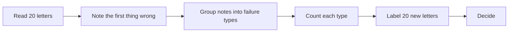

# Measure the letters

## The problem

AI drafted 20 decision letters. Some are fine. Some cite a clause that does not exist, or name the wrong child.
Before you trust 1,200 letters, you read 20 of them. You note what goes wrong, and you count it.

For example, letter A03 offers Bilal Qureshi (HH-0129) a place. It says he qualified "under clause 4.6 of our
admissions policy (distance)". But the policy has no clause 4.6. Distance is clause 4.4. The letter looks fine
until you check it.

A test set is a fixed group of cases where you know the right answer. You run the AI on it and count how often it
is right. Then you can run it again later and compare.

DXC Technology says an AI build was "80% right on the first pass"
([DXC's story on claude.com](https://claude.com/customers/dxc)). Newfront tested its AI on a fixed set of hard
questions. It reports "12 out of 20 complex insurance questions answered correctly"
([Newfront's story on claude.com](https://claude.com/customers/newfront)). A number like that comes from a test
set. In this part you make one.



This part has four steps. The last one is extra:

| Step                                                               | Minutes | What you hand in   | What the check reads                                                 |
| ------------------------------------------------------------------ | ------- | ------------------ | -------------------------------------------------------------------- |
| [read-twenty-outputs](01-read-twenty-outputs/problem/README.md)    | 15      | `letter-notes.csv` | 20 rows, a note on every fail, at least 4 of 5 planted faults caught |
| [name-the-failures](02-name-the-failures/problem/README.md)        | 10      | `failure-modes.md` | counts that add up, and a yes or no rule for each type               |
| [label-the-test-set](03-label-the-test-set/problem/README.md)      | 10      | `test-set.csv`     | at least 16 of 20 labels match the key, with a reason for each miss  |
| [test-the-judge](04-test-the-judge/problem/README.md) (go further) | 15      | `judge.md`         | how often Claude agrees with you, out of 20                          |

Read this first, if you can: [Demystifying evals for AI agents](https://www.anthropic.com/engineering/demystifying-evals-for-ai-agents).
It says to start with 20 to 50 real cases, and to read what the AI wrote.

## Walkthrough

You work in each step's `problem` folder. The first command lists the letters you read. The other commands check
each step. The Expect line under each one says what you should see.

```bash
ls world/harbour-hill/letters/batch-a
```

Expect: `01.md` to `20.md`, one file for each letter.

```bash
bun run verify read-twenty-outputs
```

Expect: `Done. All 7 rules pass.` once `letter-notes.csv` is filled in.

```bash
bun run verify name-the-failures
```

Expect: `Done. All 7 rules pass.` once `failure-modes.md` is filled in.

```bash
bun run verify label-the-test-set
```

Expect: `Done. All 7 rules pass.` once `test-set.csv` is filled in.

```bash
bun run verify test-the-judge
```

Expect: `Done. All 7 rules pass.` once `judge.md` is filled in.

```bash
bun run verify part measure-the-letters
```

Expect: `Part measure-the-letters is done: 4/4 steps pass.`

## Assignment

**The problem.** 20 letters were drafted by AI. Which can go out?

**What you hand in.** `letter-notes.csv`, `failure-modes.md` and `test-set.csv`.

**How it is checked.** Each line is a yes or no question:

| Question                                                                    | Who checks |
| --------------------------------------------------------------------------- | ---------- |
| Does `letter-notes.csv` have 20 rows, with a note on every `no`?            | the script |
| Were at least 4 of the 5 planted faults caught?                             | the script |
| Do the failure mode counts add up to the `no` rows?                         | the script |
| Is every pass rule a yes or no question?                                    | the script |
| Do at least 16 of 20 test set labels agree with the expert key?             | the script |
| Could a stranger use your pass rules on a new letter with no help from you? | a person   |

**Go further.** Give Claude your pass rules, record its labels, and report the agreement out of 20 in `judge.md`.
That is the test-the-judge step.

## Finished

You now have a test set: 20 letters with known answers, and pass rules a stranger can use. For example, when the
office changes its letter prompt, you draft new letters with the new prompt in Claude and read them with your pass
rules. Batch B in `world/harbour-hill/letters/batch-b` is a fresh set to practise on. Count the fails again. If the
count is worse than before, you do not ship it. This repo has no script that makes letters from a new prompt, so
you do this step by hand.

This part teaches the first loop: read, group, count, label. How to tune a judge until you trust it, and when to
launch, is in a separate learnwithparam course, AI Evals for PMs. It is not in this folder.

Next, in guard-the-forms, you look at a different kind of failure. A form tries to give the AI orders. You write
guard rules and test them, the same way you tested the letters.
