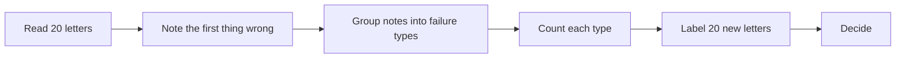

# Measure the letters

## The problem

AI drafted 20 decision letters. Some are fine. Some cite a clause that does not exist, or name the wrong child.
Before you trust 1,200 letters, you read 20, note what goes wrong, and count it.

DXC Technology says an AI build was "80% right on the first pass"
([DXC's story on claude.com](https://claude.com/customers/dxc)). Newfront tested its AI on a fixed set of hard
questions and reports "12 out of 20 complex insurance questions answered correctly"
([Newfront's story on claude.com](https://claude.com/customers/newfront)). A number like that comes from a test
set. In this part you make one.

| Step                        | Minutes | What you hand in   | What the check reads                                                 |
| --------------------------- | ------- | ------------------ | -------------------------------------------------------------------- |
| read-twenty-outputs         | 15      | `letter-notes.csv` | 20 rows, a note on every fail, at least 4 of 5 planted faults caught |
| name-the-failures           | 10      | `failure-modes.md` | counts that add up, and a yes or no rule for each type               |
| label-the-test-set          | 10      | `test-set.csv`     | at least 16 of 20 labels match the key, with a reason for each miss  |
| test-the-judge (go further) | 15      | `judge.md`         | how often Claude agrees with you, out of 20                          |

## Walkthrough

TODO(part session): one `bun run verify` command per step, each with its Expect: line.
