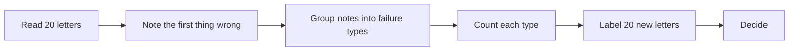

# Measure the letters

## After this part you can

Read AI output, name how it fails, and count each failure against a test set.

## You leave with

A test set: 20 letters with known answers, a table of failure modes, and pass rules a stranger can use.

## The problem

AI drafted 20 decision letters. Some are fine. Some cite a clause that does not exist, or name the wrong child. For example, letter A03 offers Bilal Qureshi (HH-0129) a place "under clause 4.6 of our admissions policy (distance)". The policy has no clause 4.6. Distance is clause 4.4. A test set is a fixed group of cases where you know the right answer. You run the AI on it and count how often it is right. Then you can run it again later and compare. DXC Technology says an AI build was "80% right on the first pass" ([DXC's story on claude.com](https://claude.com/customers/dxc)). Newfront reports "12 out of 20 complex insurance questions answered correctly" ([Newfront's story on claude.com](https://claude.com/customers/newfront)). A number like that comes from a test set. In this part you make one.



## Steps

The last step is extra. You work in each step's `problem` folder.

| Step                                                               | What you hand in   | What the check reads                                                 |
| ------------------------------------------------------------------ | ------------------ | -------------------------------------------------------------------- |
| [read-twenty-outputs](01-read-twenty-outputs/problem/README.md)    | `letter-notes.csv` | 20 rows, a note on every fail, at least 4 of 5 planted faults caught |
| [name-the-failures](02-name-the-failures/problem/README.md)        | `failure-modes.md` | counts that add up, and a yes or no rule for each type               |
| [label-the-test-set](03-label-the-test-set/problem/README.md)      | `test-set.csv`     | at least 16 of 20 labels match the key, with a reason for each miss  |
| [test-the-judge](04-test-the-judge/problem/README.md) (go further) | `judge.md`         | how often Claude agrees with you, out of 20                          |

```bash
ls world/harbour-hill/letters/batch-a
```

Expect: `01.md` to `20.md`, one file for each letter.

```bash
bun run verify read-twenty-outputs
```

Expect: `Done. All 7 rules pass.` once `letter-notes.csv` is filled in.

```bash
bun run verify name-the-failures
```

Expect: `Done. All 7 rules pass.` once `failure-modes.md` is filled in.

```bash
bun run verify label-the-test-set
```

Expect: `Done. All 10 rules pass.` once `test-set.csv` is filled in.

```bash
bun run verify test-the-judge
```

Expect: `Done. All 7 rules pass.` once `judge.md` is filled in.

```bash
bun run verify part measure-the-letters
```

Expect: `Part measure-the-letters is done: 4/4 steps pass.`

## Watch and read

| Kind | Title                                                                  | Author                | Why                                                                          | Link                                                                          |
| ---- | ---------------------------------------------------------------------- | --------------------- | ---------------------------------------------------------------------------- | ----------------------------------------------------------------------------- |
| read | Demystifying evals for AI agents                                       | Anthropic Engineering | It says to start with a few real cases and to read what the AI wrote.        | https://www.anthropic.com/engineering/demystifying-evals-for-ai-agents       |
| read | Define success criteria and build evaluations                          | Anthropic             | It shows how to turn a goal into a test, from exact match to a judge.        | https://platform.claude.com/docs/en/test-and-evaluate/develop-tests           |
| read | Writing effective tools for agents, with agents                        | Anthropic Engineering | It says to build tests from real uses and to read the raw transcripts.       | https://www.anthropic.com/engineering/writing-tools-for-agents                |
| read | Building effective AI agents                                           | Anthropic Engineering | It says to start simple and measure before you add more parts.               | https://www.anthropic.com/engineering/building-effective-agents               |

## Project

Build a test set for one real task of your own: 20 outputs, a yes or no label on each, and a failure mode table. For example, when the office changes its letter prompt, draft new letters and read them with your pass rules. Batch B in `world/harbour-hill/letters/batch-b` is a fresh set to practise on. Count the fails again. If the count is worse, you do not ship it. This repo has no script that drafts letters from a new prompt, so do that by hand.

Next, in guard-the-forms, you look at a different kind of failure. A form tries to give the AI orders. You write guard rules and test them, the same way you tested the letters.
