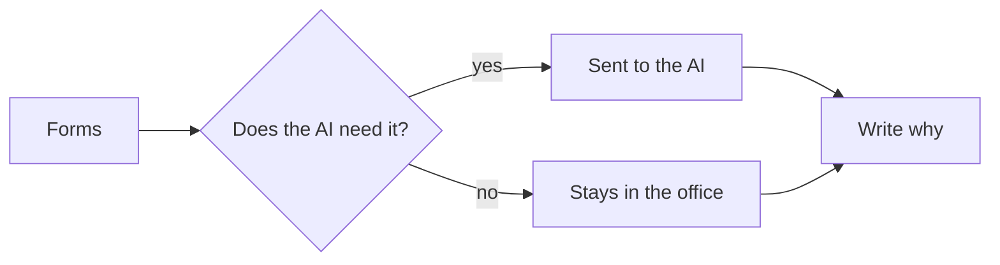
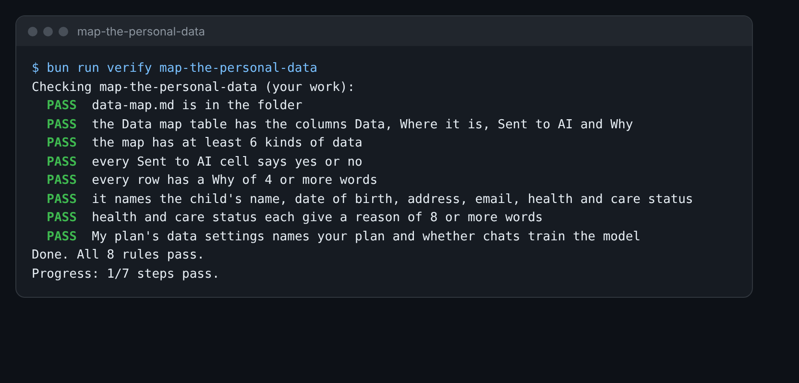

# Map the personal data

This step is extra. Do it if you have time.

## The problem

Every form holds a child's details: a name, a date of birth, a home address. Some forms say a child has a health
plan, or is in the care of the council. These are some of the most private facts about a child.

Each time you paste a form into an AI, those details leave the office. So before the office uses AI for real, you
map the data. For each kind, you say where it is, if it goes to the AI, and why.



## Your challenge

Fill in `data-map.md` in this folder.

1. Open one form, for example `world/harbour-hill/applications/01.md`. Read it from top to bottom.
2. Each thing about a person is one row in the Data map. Name at least 6 kinds.
3. In **Where it is**, name the files: forms, the register, the inbox or the letters.
4. In **Sent to AI**, write `yes` if the extraction prompt needs it. Write `no` if it can stay out.
5. In **Why**, say why, in a short sentence. Health and care status need a longer reason.
6. Open the Claude app. Go to Settings, then Privacy. Under **My plan's data settings**, write your plan and what it
   says about using your chats to improve the models.

For example, the home address is on every form in Part B. But the order only needs the distance, and the form
already gives it. So the row is:

```
| Home address | Forms, Part B | no | Only the distance is needed. The form gives it. |
```

Must name: the child's name, date of birth, home address, the parent's email, health (the EHCP) and care status
(looked-after).



## Done when

- The Data map table has the columns Data, Where it is, Sent to AI and Why.
- It has at least 6 kinds of data, including the six above.
- Every Sent to AI cell is `yes` or `no`, and every row has a Why of 4 or more words.
- Health and care status each give a reason of 8 or more words.
- My plan's data settings names your plan and what it says about training.

How this step is checked: the check reads your table and looks for each kind of data by name.

```bash
bun run verify map-the-personal-data
```

Expect: `Done. All 8 rules pass.`

## If you get stuck

| What you see                                     | Fix                                                               |
| ------------------------------------------------ | ----------------------------------------------------------------- |
| `FAIL it names the child's name, date of birth`  | Health is the EHCP question. Care status is the looked-after one. |
| `FAIL health and care status each give a reason` | Say what the AI needs: only yes or no, never the details.         |
| `FAIL My plan's data settings names your plan`   | Write Free, Pro, Max, Team or Enterprise, and what Privacy says.  |

## Words you will use

- **Personal data**: any fact about a real person, such as a name or a date of birth.
- **Looked-after child**: a child in the care of the council. It is a very private fact.
- **EHCP**: a plan for a child with extra health or learning needs.
