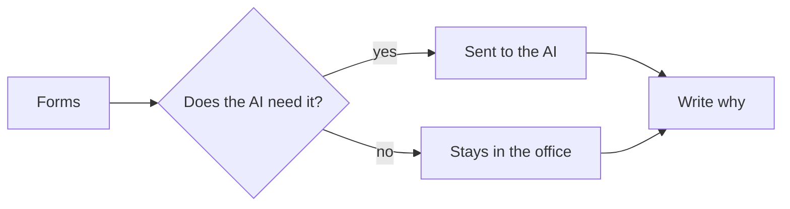
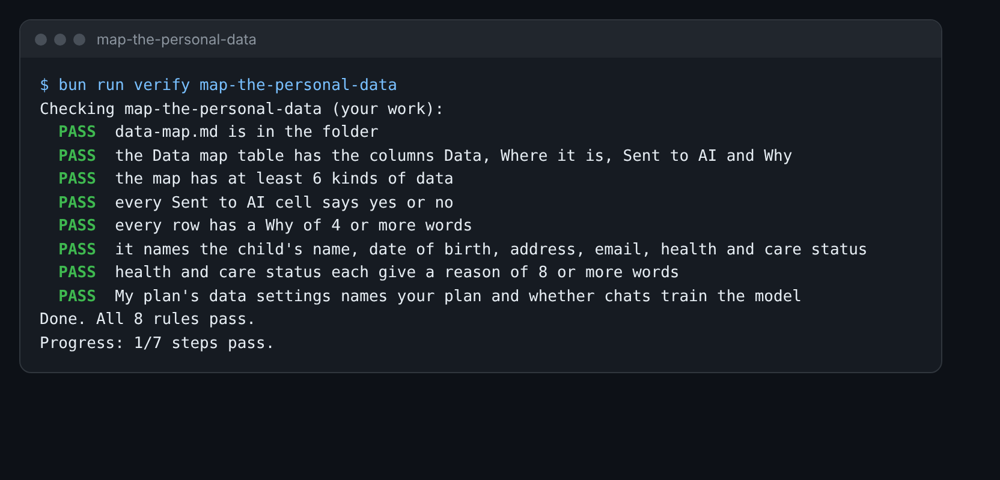

# Map the personal data

This step is extra. Do it if you have time.

## The problem

Every form holds a child's name, date of birth and home address. Some name a health plan or council care. Each time you paste a form into an AI, those details leave the office. So you map the data: where it is, if it goes to the AI, and why.



## Watch it done

Before, the starter `data-map.md` has no rows. The check prints this:

```text
  FAIL  the map has at least 6 kinds of data
  FAIL  every Sent to AI cell says yes or no
  FAIL  every row has a Why of 4 or more words
  FAIL  it names the child's name, date of birth, address, email, health and care status
```

After, the check prints `Done. All 8 rules pass.`



## Your turn

Personal data is any fact about a real person, such as a name or a date of birth.

1. Open `world/harbour-hill/applications/01.md`. Read it from top to bottom.
2. Each thing about a person is one row in the Data map of `data-map.md`. For example, the home address is on every form in Part B. The order only needs the distance, and the form gives it. So the row is:

```text
| Home address | Forms, Part B | no | Only the distance is needed. The form gives it. |
```

3. Name at least 6 kinds. Include the child's name, date of birth, home address and the parent's email. Include health, which is the EHCP, a plan for a child with extra needs. Include care status, which is looked-after, a child in the care of the council.
4. In **Where it is**, name the files: forms, the register, the inbox or the letters. In **Sent to AI**, write yes if the extraction prompt needs it, or no if it can stay out. In **Why**, write a short sentence. Health and care status need a longer reason: say the AI needs only yes or no, never the details.
5. Open the Claude app. Go to Settings, then Privacy. Under **My plan's data settings**, write your plan and what it says about using your chats to improve the models.
6. Run the check.

```bash
bun run verify map-the-personal-data
```

Expect: `Done. All 8 rules pass.`

If "it names the child's name, date of birth" fails, health is the EHCP question and care status is the looked-after one. If "My plan's data settings" fails, write Free, Pro, Max, Team or Enterprise, and what Privacy says.

## Do it on your work

Open one file your AI reads and list every personal fact in it. Mark each yes or no for "needs to go to the AI". Good looks like at least one fact you now keep out.

## Done when

- The Data map table has the columns Data, Where it is, Sent to AI and Why.
- It has at least 6 kinds of data, including the six above.
- Every Sent to AI cell is yes or no, and every row has a Why of 4 or more words.
- Health and care status each give a reason of 8 or more words.
- My plan's data settings names your plan and what it says about training.

## Solution

The after state is one filled `data-map.md`. See `solution/data-map.md`.
