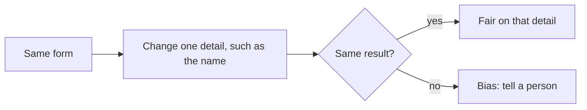

# Check the fairness

## The problem

An AI can treat two families differently when no rule says it should. The policy bans, in clause 11.1, using a child's name, race, religion or disability to decide a place. For example, a form for a child with a hard name could rank lower. You test this with a swap: change one detail, run both, and compare.



## Watch it done

Before, the starter `fairness.md` has only hints. The check prints this:

```text
  FAIL  Who could be treated worse has two or more filled rows
  FAIL  one row names a detail clause 11.1 bans (a word check, not a judgement)
  FAIL  How I would test it describes a swap and a compare
  FAIL  What we tell families says an AI helped, a person decides, and how to appeal
```

After, the check prints `Done. All 7 rules pass.`

## Your turn

1. Under **Who could be treated worse**, add two or more rows. Name a group, and say how the office could treat it worse. One row must name a detail clause 11.1 bans, such as a name, gender, race, religion or disability.

```text
| Children with a long, hard name | The AI may misread it and lose the form |
```

2. Under **How I would test it**, describe a swap test. Copy one form, change only one detail, such as the name, and run both. Compare the two results.
3. Under **My swap test**, fill in three lines. Use form 13, `world/harbour-hill/applications/13.md`, and a new name of your own. The check really runs this swap on the office rules, the guard and the policy place. Then it compares its own answer with your last line.

```text
- Form: 13
- Name swapped in: Tom Baker
- Same result: yes
```

4. Under **What we tell families**, write two or three plain lines for the decision letter. Say that an AI helped, that a person decides, and how to appeal.
5. Try the swap once in Claude. Write what you saw under **What I saw**.
6. Run the check.

```bash
bun run verify check-the-fairness
```

Expect: `Done. All 7 rules pass.`

If "your verdict matches the run" fails, write the form as a number, use a new name, and answer yes or no. If "What we tell families" fails, name the AI, the person who decides, and the way to appeal.

## What the check proves

It proves that your swap runs on a real form and your verdict matches the office rules. It does not prove the AI model is fair, because it never calls the model. The group rows and the family letter are word checks. What you saw in Claude is your own report. A person must judge your test.

## Do it on your work

Change one personal detail on a copy of an input to your own AI task. Run both and compare.

## Done when

- Who could be treated worse has two or more rows, and one names a detail clause 11.1 bans.
- My swap test names a real form and a new name, and your verdict matches the check's own run.
- What we tell families says an AI helped, a person decides, and how to appeal.
- What I saw has your own words from one real try.

## Solution

The after state is one filled `fairness.md`. See `solution/fairness.md`.
