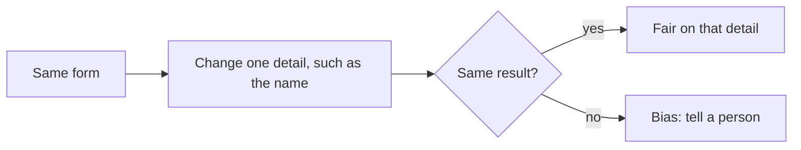

# Check the fairness

## The problem

An AI can treat two families differently when nothing in the rules says it should. It may rank a form lower
because of a name, or an odd spelling, or the way a parent writes. This is bias. Clause 11.1 of the policy bans
using a child's name, race, religion or disability to decide a place. Families also have a right to know that an AI
helped. Telling them is called disclosure.



## Your challenge

Fill in `fairness.md` in this folder.

1. Under **Who could be treated worse**, add two or more rows. Name a group, and say how the office could treat it
   worse. Include one thing clause 11.1 bans.
2. Under **How I would test it**, describe a swap test. Copy one form, change only one detail, such as the name,
   and run both. Compare the two results. If they differ, you found bias.
3. Under **What we tell families**, write two or three plain lines for the decision letter. Say that an AI helped,
   that a person decides, and how to appeal.
4. Try the swap test once by hand in Claude on one form, and write what you saw under **What I saw**.

For example, a row can read: `Children with a long, hard name | The AI may misread it and lose the form`.

## Done when

- **Who could be treated worse** has two or more rows, and one is a thing clause 11.1 bans.
- **How I would test it** describes a swap: change one detail and compare the results.
- **What we tell families** says an AI helped, a person decides, and how to appeal.
- **What I saw** has your own words from one real try.

How this step is checked: the check reads `fairness.md`. It checks shape and that you wrote each part. It does not
judge whether your test is good. A person does that.

```bash
bun run verify check-the-fairness
```

Expect: `Done. All 6 rules pass.`

## If you get stuck

| What you see                               | Fix                                                                 |
| ------------------------------------------ | ------------------------------------------------------------------- |
| `FAIL one row is a thing clause 11.1 bans` | Name a banned detail: a name, gender, race, religion or disability. |
| `FAIL How I would test it describes...`    | Say you change only one detail and compare the two results.         |
| `FAIL What we tell families says...`       | Name the AI, the person who decides, and the way to appeal.         |

## Words you will use

- **Bias**: the AI treats two cases differently when the rules say they are the same.
- **Swap test**: run the same form twice, changing one detail, to see if the result changes.
- **Disclosure**: telling people that an AI helped, and who still decides.
