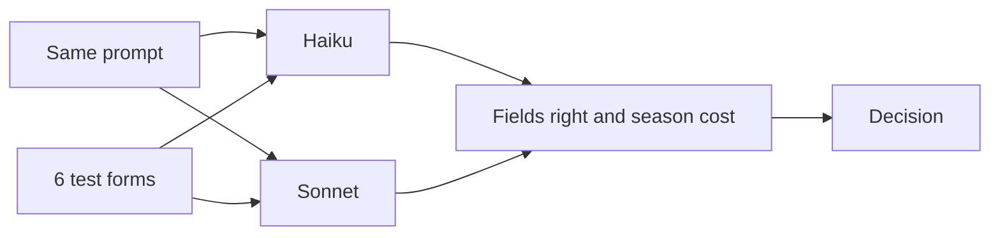
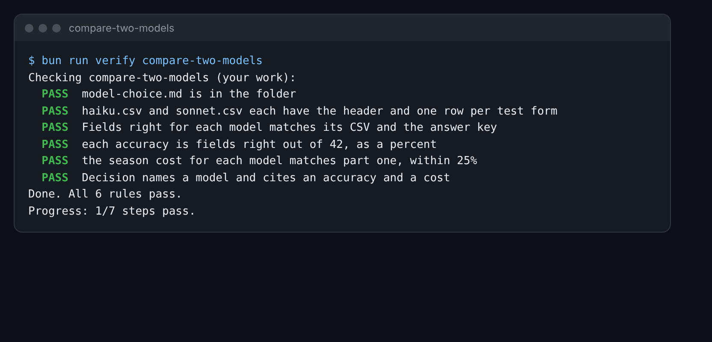

# Compare two models

## The problem

Your boss asks which model to use. Most people pick the one they have heard of. You can do better.

Run the same prompt on the same six forms with two models. Score both against the answer key. For example, Haiku got 39 of 42 fields right, and Sonnet got 42.



## Watch it done

Before, `model-choice.md` says `(write here)` in every cell. After, it shows both models side by side, and a decision that cites both:

| Model  | Fields right | Fields checked | Accuracy | Season cost |
| ------ | ------------ | -------------- | -------- | ----------- |
| Haiku  | 39           | 42             | 92.9%    | $0.47       |
| Sonnet | 42           | 42             | 100%     | $9.36       |



## Your turn

You work in this `problem/` folder. The prompt is in `prompt.md`. The answer key is `world/keys/applications.csv`. The six forms are `applications/16.md`, `18.md`, `20.md`, `22.md` and the scans `28.png` and `30.png`.

1. In the Claude app, pick Haiku in the model menu. Paste the prompt from `prompt.md` and one form, one chat per form. Paste each row Claude gives into `haiku.csv`, on the line with the same application id.
2. Pick Sonnet and do it again. Paste the rows into `sonnet.csv`.
3. Compare each CSV with the key, field by field. Each CSV has 42 fields: 6 forms times 7 fields. Count the fields that match. A different date or number is wrong.
4. Fill in `model-choice.md`. For the season cost, copy each model's cost for 1,200 forms from your `season-cost.md` in price-the-season. Do not use the cost of one form.
5. Write your Decision in one paragraph: the model, a percent, and a dollar cost.
6. Run the check.

```bash
bun run verify compare-two-models
```

Expect: `Done. All 6 rules pass.`

If you see `FAIL Fields right for each model matches`, count again. For example, if Haiku said form 22 has a sibling, that is wrong. The form names a cousin, and a cousin does not count. If you see `FAIL Decision names a model and cites`, put the model name, a percent and a cost in the same paragraph.

On the Free plan, a model may be missing from your menu. Then copy `haiku.csv` and `sonnet.csv` from `../solution/` into this folder, and count those. Those files are recorded sample answers.

## Do it on your work

Take one task you repeat, and six real cases with a known right answer. Run one prompt on two models. Count the right answers, and price a season for each. A good answer is a decision that names both numbers.

## Done when

- `haiku.csv` and `sonnet.csv` each have the header and one row per test form.
- Fields right for each model matches its CSV and the answer key.
- Each accuracy is fields right out of 42, as a percent.
- The season cost for each model matches price-the-season, within 25%.
- Decision names a model and cites an accuracy and a cost.

The check does not run any model. It scores your two CSVs against the key itself, checks that your counts match, and works out the season cost again from the price list.

## Solution

The finished state is `model-choice.md` plus the two CSVs. See `solution/` for recorded sample answers.
