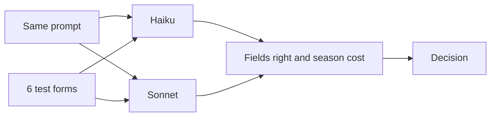
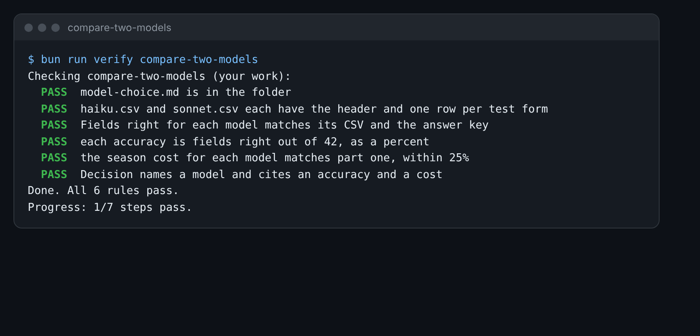

# Compare two models

## The problem

Your boss asks: "Which model should we use?" Most people pick the one they have heard of. You can do better. You
have a cost for each model from price-the-season. Now you need how often each one is right.

So you run the same prompt on the same forms with two models. You score both against the answer key. Then you
decide, with both numbers in front of you.



## Your challenge

1. Open `prompt.md` in this folder. It is the prompt both models get.
2. In the Claude app, pick Haiku in the model menu. Run the prompt on each of these forms, one chat each:
   `applications/16.md`, `18.md`, `20.md`, `22.md`, and the scans `28.png` and `30.png`.
3. Paste each row Claude gives into `haiku.csv`, on the line with the same application id.
4. Pick Sonnet in the menu and do it again. Paste the rows into `sonnet.csv`.
5. Open `world/keys/applications.csv`. Compare each CSV with the key, field by field. Each CSV has 42 fields: 6
   forms times 7 fields. Count the fields that match.
6. Fill in `model-choice.md`. Copy each season cost from your `season-cost.md` in price-the-season.
7. Write your Decision. Name the model, and give its accuracy and its season cost.

For example, if Haiku said form 22 has a sibling, that is wrong. The form names a cousin, and a cousin does not
count. If that was Haiku's only mistake, it got 41 of 42 right. That is 41 divided by 42, times 100: 97.6%.

On the Free plan, if a model is not in your menu, ask your teacher for their CSVs.



## Done when

- `haiku.csv` and `sonnet.csv` each have the header and one row per test form.
- Fields right for each model matches its CSV and the answer key.
- Each accuracy is fields right out of 42, as a percent.
- The season cost for each model matches part one, within 25%.
- Decision names a model and cites an accuracy and a cost.

How this step is checked: the check scores your two CSVs against the key itself. Then it checks that your counts
match. It works out the season cost again from the price list.

```bash
bun run verify compare-two-models
```

Expect: `Done. All 6 rules pass.`

## If you get stuck

| What you see                                  | Fix                                                                    |
| --------------------------------------------- | ---------------------------------------------------------------------- |
| `FAIL Fields right for each model matches`    | Count again, one field at a time. A different date or number is wrong. |
| `FAIL the season cost for each model matches` | Use the season cost, for 1,200 forms, not the cost of one form.        |
| `FAIL Decision names a model and cites`       | Write the model name, a percent, and a dollar cost in one paragraph.   |

## Words you will use

- **Accuracy**: how many fields a model got right, out of all the fields you checked.
- **Model menu**: the list in the Claude app where you pick Haiku, Sonnet or Opus.
- **Decision**: the model you pick, with the numbers that make the case.
