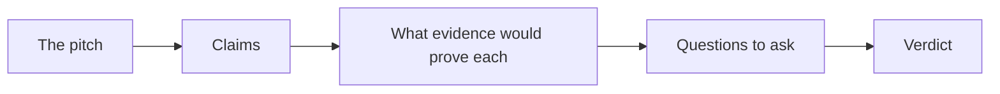
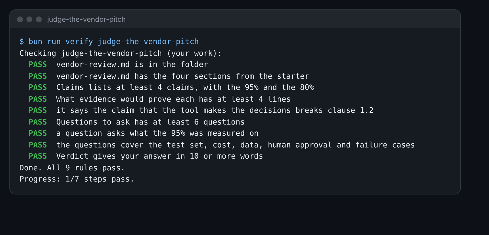

# Judge the vendor pitch

## The problem

A vendor sent the school a sales pitch. It is in `world/harbour-hill/vendor-pitch.md`. It says the tool is "95%
accurate" and "saves 80% of staff time". Your boss likes the numbers and wants a yes or no.

A number with no test behind it is a claim, not a fact. You now know how a real number is made: a test set, a key,
a count. So you can ask the questions that turn a claim into a fact, or show it is empty.



## Your challenge

Fill in `vendor-review.md` in this folder.

1. Read `world/harbour-hill/vendor-pitch.md`. Under **Claims**, copy each claim it makes, one per line.
2. Under **What evidence would prove each**, write what you would need to see to believe each claim.
3. Read clause 1.2 of `world/harbour-hill/policy/admissions-policy-2027.md`. Does any claim break it? Say so.
4. Under **Questions to ask**, write at least 6 questions. Cover: what the 95% was measured on, the test set, the
   cost per application, where the data goes, who approves, and what happens when it is wrong.
5. Under **Verdict**, say yes, no or not yet, and the one reason that matters most.
6. When your check passes, open `../solution/vendor-review.md`. Compare it with yours. What did you ask that it did
   not?

For example, "95% accurate" leaves out 95% of what. Is it 95% of fields, of forms, or of decisions? A tool that
gets 95% of fields right can still get many forms wrong. So one question is:

```
1. 95% of what? Fields, forms or decisions?
```



## Done when

- `vendor-review.md` has Claims, What evidence would prove each, Questions to ask and Verdict.
- Claims lists at least 4 claims, with the 95% and the 80%.
- What evidence would prove each has at least 4 lines.
- It says the claim that the tool makes the decisions breaks clause 1.2.
- Questions to ask has at least 6 questions, one on what the 95% was measured on.
- The questions cover the test set, cost, data, human approval and failure cases.
- Verdict gives your answer in 10 or more words.

How this step is checked: the check reads your file. It looks for each topic by its words, such as "test set",
"cost", "data", "approve" and "wrong".

```bash
bun run verify judge-the-vendor-pitch
```

Expect: `Done. All 9 rules pass.`

## If you get stuck

| What you see                                  | Fix                                                          |
| --------------------------------------------- | ------------------------------------------------------------ |
| `FAIL it says the claim that the tool makes`  | Read clause 1.2. Then read the Fully automatic claim again.  |
| `FAIL Questions to ask has at least 6`        | Each question is a list line that ends with a question mark. |
| `FAIL the questions cover the test set, cost` | Ask one question for each topic in step 4 of Your challenge. |

## Words you will use

- **Vendor**: a company that sells you a product.
- **Claim**: something a vendor says is true, with no proof yet.
- **Evidence**: what you would need to see to believe a claim, such as test results on your own forms.
