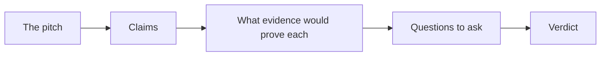
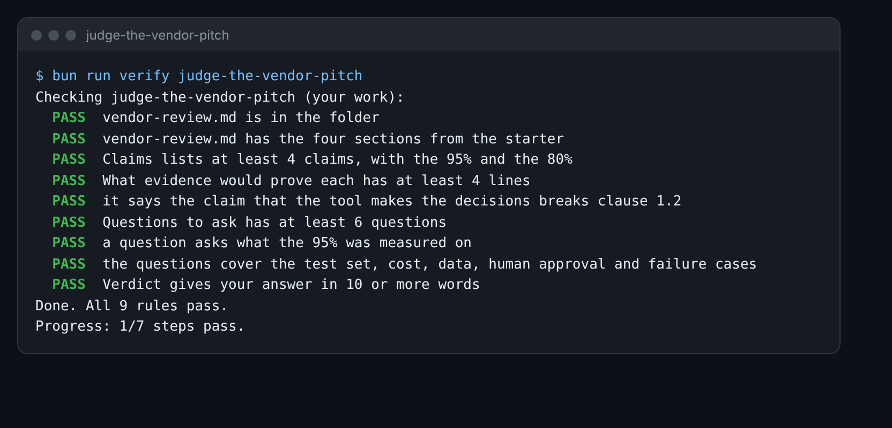

# Judge the vendor pitch

## The problem

A vendor is a company that sells you a product. This vendor's pitch says the tool is "95% accurate" and "saves 80% of staff time". It never says 95% of what. A number with no test behind it is a claim, not a fact. Your boss wants a yes or no.



## Watch it done

Before, `vendor-review.md` says `(write here)` under four headings. After, each claim has evidence next to it and the review has six or more questions. For example, one question is: "95% of what? Fields, forms or decisions?" A tool can get 95% of fields right and still get many forms wrong.



## Your turn

You work in this `problem/` folder. The pitch is `world/harbour-hill/vendor-pitch.md`.

1. Read the pitch. Under **Claims**, copy each claim it makes, one per line. Include the 95% and the 80%.
2. Under **What evidence would prove each**, write what you would need to see to believe each claim.
3. Read clause 1.2 of the policy in `world/harbour-hill/policy/`. Does any claim break it? Say so. For example, a tool that "makes the decisions" breaks clause 1.2, because a person makes every admission decision.
4. Under **Questions to ask**, write at least 6 questions, one per line, each ending with a question mark. Ask what the 95% was measured on. Ask about the test set, the cost per application, where the data goes, who approves, and what happens when it is wrong.
5. Under **Verdict**, say yes, no or not yet, and the one reason that matters most, in 10 or more words.
6. Run the check.

```bash
bun run verify judge-the-vendor-pitch
```

Expect: `Done. All 9 rules pass.`

If you see `FAIL it says the claim that the tool makes`, read clause 1.2, then read the fully automatic claim again. If you see `FAIL the questions cover the test set, cost`, ask one question for each topic in move 4.

When it passes, open `../solution/vendor-review.md` and compare. What did you ask that it did not?

## Do it on your work

Take one pitch, ad or case study you have seen about AI, for example "a 99% reduction in audit costs". Ask the same questions: reduced from what, measured on which cases, who checked? Good looks like a list of questions the vendor has to answer before you say yes.

## Done when

- `vendor-review.md` has Claims, What evidence would prove each, Questions to ask and Verdict.
- Claims has at least 4 claims, with the 95% and the 80%.
- What evidence would prove each has at least 4 lines.
- It says the claim that the tool makes the decisions breaks clause 1.2.
- Questions to ask has at least 6 questions, one on what the 95% was measured on.
- The questions cover the test set, cost, data, human approval and failure cases.
- Verdict gives your answer in 10 or more words.

The check does not read for meaning. It looks for topic words such as "test set", "cost", "data", "approve" and "wrong". A person decides if your questions are good ones.

## Solution

The after state is one `vendor-review.md`. See `solution/vendor-review.md` for a sample.
