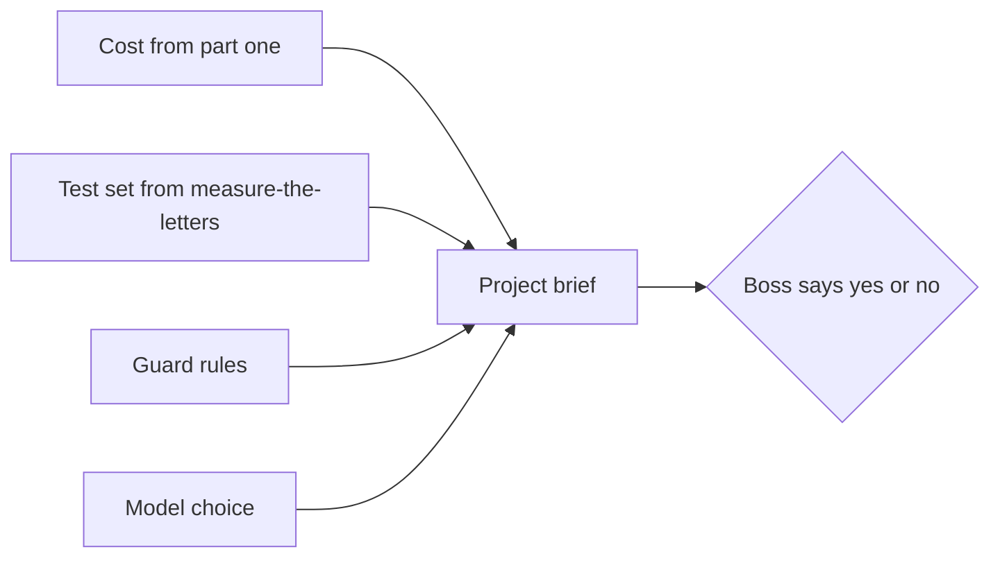
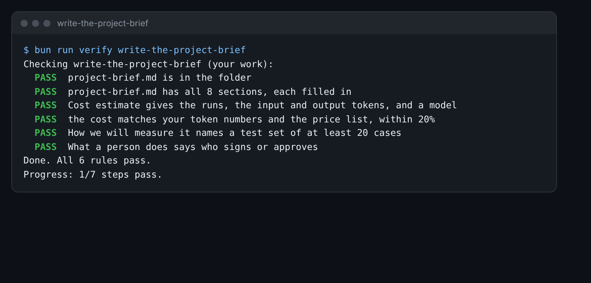

# Write the project brief

## The problem

Your boss does not want a chat log. They want one page they can say yes or no to. What is the problem? What will
the AI do, and what will a person do? What will it cost, and how will you know it works?

A project brief is that page. You have every part of it already: a cost, a test set, guard rules and a model
choice. Now you put them together, for one task.



## Your challenge

Fill in `project-brief.md` in this folder. Pick one task. It can be a task from your own job, like the one in your
`about-me.md`. Or it can be the Harbour Hill forms.

1. Write under each of the 8 headings. A few sentences is enough.
2. Under **Cost estimate**, fill in each line: runs, input tokens per run, output tokens per run, the model, and
   the cost. Work the cost out the same way as in price-the-season.
3. Under **How we will measure it**, say how many real cases you will label as a test set. Start with 20 or more.
4. Under **What a person does**, name the person, by role, who approves or signs.

For example, the Harbour Hill cost lines are:

```
- Runs in a season: 1,200
- Input tokens per run: 2,402 (one form plus the whole policy)
- Output tokens per run: 300
- Model: Sonnet
- Cost: $9.36 a season
```

That is 2,402 times $2, plus 300 times $10, divided by 1,000,000, times 1,200. Part one used form 03, so it had
2,388 tokens and $9.33. Here the form is the average form, 586 tokens, so the total is a little higher. A full Harbour Hill brief is in
`../solution/project-brief.md`. Read it after you write your own.

Do not put real names, emails or dates of birth in your brief. Describe the data, never copy it.



## Done when

- `project-brief.md` has all 8 sections, each filled in.
- Cost estimate gives the runs, the input and output tokens, and a model.
- The cost matches your token numbers and the price list, within 20%.
- How we will measure it names a test set of at least 20 cases.
- What a person does says who signs or approves.

How this step is checked: the check reads your page. It works out the cost again from your own token numbers and
the price list. In a cohort, a person also reads it and asks: would a stranger know what happens when the AI is
wrong?

```bash
bun run verify write-the-project-brief
```

Expect: `Done. All 6 rules pass.`

## If you get stuck

| What you see                                   | Fix                                                              |
| ---------------------------------------------- | ---------------------------------------------------------------- |
| `FAIL Cost estimate gives the runs`            | Keep the five lines from the starter, and put a number on each.  |
| `FAIL the cost matches your token numbers`     | Divide by 1,000,000, then times the runs. Check one sum by hand. |
| `FAIL How we will measure it names a test set` | Write a number and a word, like: 20 letters, or 30 emails.       |

## Words you will use

- **Project brief**: one page that says what you will build, what it costs and how you will know it works.
- **Source of truth**: the file or system that holds the right answer, such as the register.
- **Run**: one call to the AI, such as reading one form.
