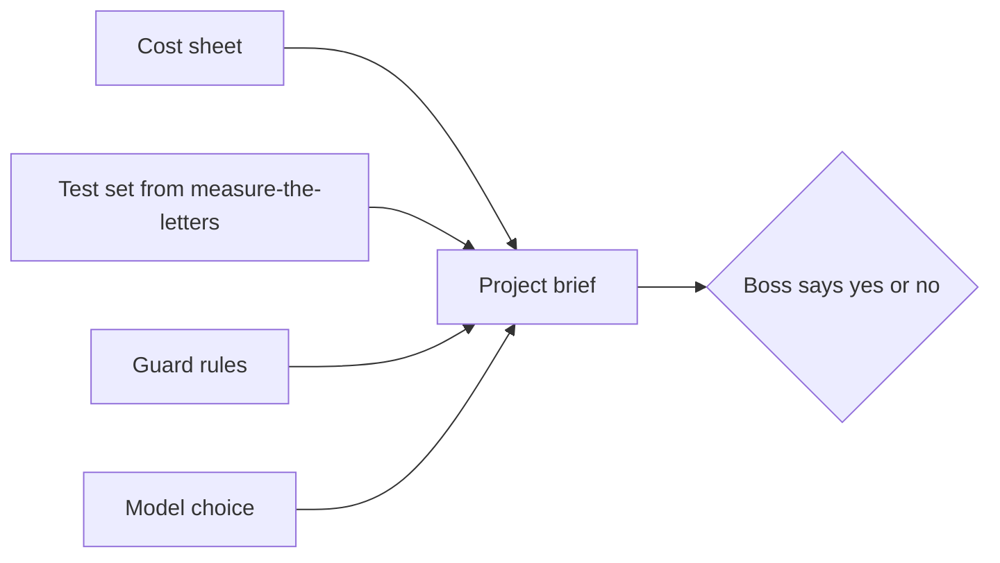
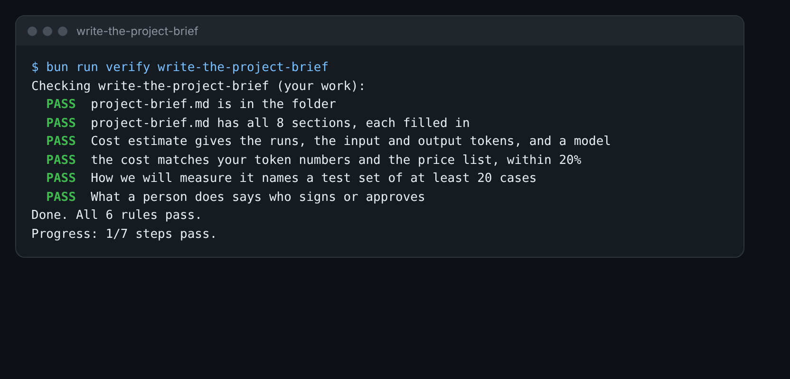

# Write the project brief

## The problem

Your boss does not want a chat log. They want one page they can say yes or no to. A project brief is that page: what you will build, what it costs and how you will know it works. For example, 1,200 forms a season on Sonnet costs $9.36.



## Watch it done

Before, `project-brief.md` has eight headings and `(write here)` under each. After, each heading is filled in and the cost lines have numbers:

```text
- Runs in a season: 1,200
- Input tokens per run: 2,402 (one form plus the whole policy)
- Output tokens per run: 300
- Model: Sonnet
- Cost: $9.36 a season
```



## Your turn

You work in this `problem/` folder. Pick one task. It can be from your own job, like the one in your `about-me.md`, or the Harbour Hill forms.

1. Write under each of the 8 headings. A few sentences is enough.
2. Under **Cost estimate**, keep the five lines and put a number on each: runs, input tokens per run, output tokens per run, the model and the cost.
3. Work the cost out like this: input tokens times the input price, plus output tokens times the output price, divided by 1,000,000, times the runs. For Harbour Hill that is 2,402 times $2, plus 300 times $10, divided by 1,000,000, times 1,200.
4. Under **How we will measure it**, name a test set of 20 or more real cases, like 20 letters.
5. Under **What a person does**, name the person, by role, who approves or signs.
6. Run the check.

```bash
bun run verify write-the-project-brief
```

Expect: `Done. All 6 rules pass.`

If you see `FAIL the cost matches your token numbers`, check one sum by hand. Do not put real names, emails or dates of birth in your brief. Describe the data, never copy it.

When it passes, read `../solution/project-brief.md` and compare.

## Do it on your work

Use a task from your own job. Count the tokens in one real input, pick a model, and fill in the cost lines. Good looks like a brief where a stranger can see what happens when the AI is wrong. Go further: ask a colleague to read it and say yes or no.

## Done when

- `project-brief.md` has all 8 sections, each filled in.
- Cost estimate gives the runs, the input and output tokens, and a model.
- The cost matches your token numbers and the price list, within 20%.
- How we will measure it names a test set of at least 20 cases.
- What a person does says who signs or approves.

The check works out the cost again from your token numbers and looks for the headings. It cannot judge the writing. In a cohort, a person reads it and asks: would a stranger know what happens when the AI is wrong?

## Solution

The after state is one `project-brief.md`. See `solution/project-brief.md` for the Harbour Hill brief.
