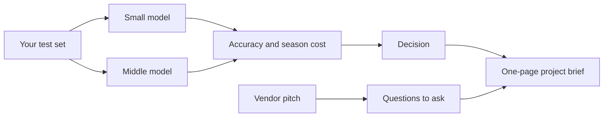

# Choose and argue

## The problem

A vendor says its tool is "95% accurate" and "saves 80% of staff time". Your boss wants a decision. You now have
a cost sheet, a test set and guard rules. Use them: pick a model with your own numbers, test the pitch, and write
a one-page brief.

Carta Healthcare says it cut clinical data work "by up to 66%"
([Carta Healthcare's story on claude.com](https://claude.com/customers/carta-healthcare)). AES says AI agents gave
"a 99% reduction in audit costs"
([Google Cloud's list of use cases](https://cloud.google.com/transform/101-real-world-generative-ai-use-cases-from-industry-leaders)).
These are the companies' own claims. You will learn to ask what each one was measured on.

| Step | Minutes | What you hand in | What the check reads |
|---|---|---|---|
| compare-two-models | 15 | `model-choice.md` | accuracy and season cost for two models, a decision that cites both |
| judge-the-vendor-pitch | 10 | `vendor-review.md` | the claims, the evidence each needs, at least six questions, a verdict |
| write-the-project-brief | 15 | `project-brief.md` | eight sections, a cost with its token numbers, a test set size |

## Walkthrough

TODO(part session): one `bun run verify` command per step, each with its Expect: line.
