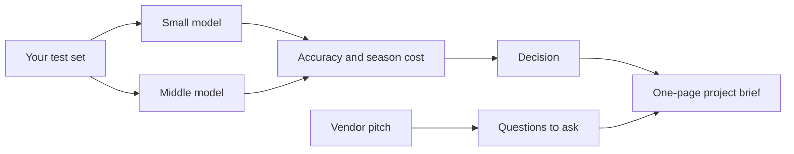

# Choose and argue

## After this part you can

Pick a model with your own numbers, test a vendor's pitch, and write a one-page brief your boss can answer yes or no to.

## You leave with

A `project-brief.md` with real numbers behind it, plus `model-choice.md` and `vendor-review.md`.

## The problem

A vendor says its tool is "95% accurate" and "saves 80% of staff time". Your boss wants a decision.

Carta Healthcare says it cut clinical data work "by up to 66%" ([Carta Healthcare's story on claude.com](https://claude.com/customers/carta-healthcare)). AES says AI agents gave "a 99% reduction in audit costs" ([Google Cloud's list of use cases](https://cloud.google.com/transform/101-real-world-generative-ai-use-cases-from-industry-leaders)). These are the companies' own claims, and each leaves out what it was measured on.

For example, the pitch for a made-up tool called Sortwell Admit says "95% accurate" and "makes the decisions". But clause 1.2 of the school's policy says a person makes every decision. So that claim is a problem, not a feature.



## Steps

| Step                                                                    | What you hand in                                | What the check reads                                                   |
| ----------------------------------------------------------------------- | ----------------------------------------------- | ---------------------------------------------------------------------- |
| [compare-two-models](01-compare-two-models/problem/README.md)           | `model-choice.md`, `haiku.csv` and `sonnet.csv` | accuracy and season cost for two models, a decision that cites both    |
| [judge-the-vendor-pitch](02-judge-the-vendor-pitch/problem/README.md)   | `vendor-review.md`                              | the claims, the evidence each needs, at least six questions, a verdict |
| [write-the-project-brief](03-write-the-project-brief/problem/README.md) | `project-brief.md`                              | eight sections, a cost with its token numbers, a test set size         |

You work in each step's `problem` folder. The first command shows the pitch you will judge.

```bash
cat world/harbour-hill/vendor-pitch.md
```

Expect: the title of the Sortwell Admit pitch at the top.

```bash
bun run verify compare-two-models
```

Expect: `Done. All 6 rules pass.` once `model-choice.md` and the two CSVs are filled in.

```bash
bun run verify judge-the-vendor-pitch
```

Expect: `Done. All 9 rules pass.` once `vendor-review.md` is filled in.

```bash
bun run verify write-the-project-brief
```

Expect: `Done. All 6 rules pass.` once `project-brief.md` is filled in.

```bash
bun run verify part choose-and-argue
```

Expect: `Part choose-and-argue is done: 3/3 steps pass.`

What the checks can and cannot do. No check here runs a model. You run the models in the Claude app.

Step one scores your CSVs against the answer key and works out the cost again. Steps two and three look for headings and topic words, and step three redoes the cost sum. A person has to judge whether your questions and your brief are good.

## Watch and read

| Kind  | Title                                  | Author                                               | Why                                                                      | Link                                                                     |
| ----- | -------------------------------------- | ---------------------------------------------------- | ------------------------------------------------------------------------ | ------------------------------------------------------------------------ |
| read  | Define your success criteria           | Anthropic, Claude docs                               | How to turn "good" into something you can measure and test.              | https://platform.claude.com/docs/en/test-and-evaluate/define-success     |
| read  | Choosing the right model               | Anthropic, Claude docs                               | The trade-off between cost, speed and quality, in one page.              | https://platform.claude.com/docs/en/about-claude/models/choosing-a-model |
| read  | Your AI Product Needs Evals            | Hamel Husain                                         | Why you test on your own cases and not on a headline number.             | https://hamel.dev/blog/posts/evals/                                      |
| read  | Starting to read the AI Snake Oil      | Arvind Narayanan and Sayash Kapoor                   | How to question a vendor's claim about what an AI tool can do.           | https://www.normaltech.ai/p/starting-reading-the-ai-snake-oil            |
| video | Why AI evals are the hottest new skill | Lenny Rachitsky with Hamel Husain and Shreya Shankar | Two experts on why a "99% accurate" claim needs a test behind it.        | https://www.youtube.com/watch?v=BsWxPI9UM4c                              |
| video | Prompting 101                          | Anthropic                                            | Watch a prompt for a real task get built, the kind you test in step one. | https://www.youtube.com/watch?v=FMWRfZ_VNdw                              |

## Project

Take the brief to your own job. Swap the forms for your own task, keep the same steps, and run the same checks. For example: "1,200 forms a season. Sonnet costs $9.36 and got 42 of 42 fields right on our test forms. A person signs every letter." Your boss can say yes or no to that.

Hand in `model-choice.md` with its two CSVs, `vendor-review.md` and `project-brief.md`. A person checks two things. Does the brief name who signs each action, by role? Would a stranger know what happens when the AI is wrong?

For more practice, turn your brief into a pilot pack, a repo with your files from every part and `bun run verify --report` with every step passing.
