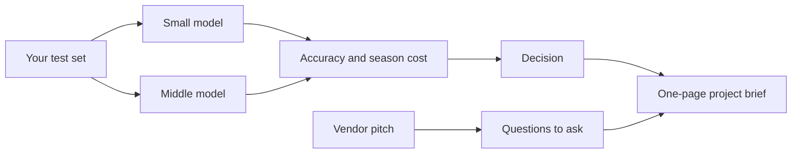

# Choose and argue

## The problem

A vendor is a company that sells you a product. One vendor says its tool is "95% accurate" and "saves 80% of
staff time". Your boss wants a decision.

You now have a cost sheet, a test set and guard rules. Use them in three ways:

- Pick a model with your own numbers.
- Test the vendor's sales pitch.
- Write a one-page project brief: a short plan your boss can say yes or no to.

For example, the pitch in `world/harbour-hill/vendor-pitch.md` is for a made-up tool called Sortwell Admit. It
says "95% accurate", but it does not say 95% of what, or on which forms. It also says the tool "makes the
decisions". But clause 1.2 of the school's policy says a person makes every admission
decision. So that claim is a problem, not a feature.

Carta Healthcare says it cut clinical data work "by up to 66%"
([Carta Healthcare's story on claude.com](https://claude.com/customers/carta-healthcare)). AES says AI agents gave
"a 99% reduction in audit costs"
([Google Cloud's list of use cases](https://cloud.google.com/transform/101-real-world-generative-ai-use-cases-from-industry-leaders)).
These are the companies' own claims. You will learn to ask what each one was measured on.



This part has three steps:

| Step                                                                    | Minutes | What you hand in                                | What the check reads                                                   |
| ----------------------------------------------------------------------- | ------- | ----------------------------------------------- | ---------------------------------------------------------------------- |
| [compare-two-models](01-compare-two-models/problem/README.md)           | 15      | `model-choice.md`, `haiku.csv` and `sonnet.csv` | accuracy and season cost for two models, a decision that cites both    |
| [judge-the-vendor-pitch](02-judge-the-vendor-pitch/problem/README.md)   | 10      | `vendor-review.md`                              | the claims, the evidence each needs, at least six questions, a verdict |
| [write-the-project-brief](03-write-the-project-brief/problem/README.md) | 15      | `project-brief.md`                              | eight sections, a cost with its token numbers, a test set size         |

Read this if you want more practice:
[Loadsure on Google Cloud](https://cloud.google.com/blog/topics/financial-services/loadsure-data-drive-insurance-claims-AI-eliminates-manual-processing).
It is one company's own claim. Ask it the same questions you ask the vendor.

## Walkthrough

You work in each step's `problem` folder. The first command shows the pitch you will judge. The other commands
check each step. The Expect line under each one says what you should see.

```bash
cat world/harbour-hill/vendor-pitch.md
```

Expect: `# Sortwell Admit: the admissions assistant for busy schools` at the top.

```bash
bun run verify compare-two-models
```

Expect: `Done. All 6 rules pass.` once `model-choice.md` and the two CSVs are filled in.

```bash
bun run verify judge-the-vendor-pitch
```

Expect: `Done. All 9 rules pass.` once `vendor-review.md` is filled in.

```bash
bun run verify write-the-project-brief
```

Expect: `Done. All 6 rules pass.` once `project-brief.md` is filled in.

```bash
bun run verify part choose-and-argue
```

Expect: `Part choose-and-argue is done: 3/3 steps pass.`

## Assignment

**The problem.** A vendor says "95% accurate", and your boss wants a decision soon.

**What you hand in.** `model-choice.md` with its two CSVs, `vendor-review.md` and `project-brief.md`.

**How it is checked.** Each line is a yes or no question:

| Question                                                                         | Who checks |
| -------------------------------------------------------------------------------- | ---------- |
| Does `model-choice.md` cite an accuracy and a cost that match your own CSVs?     | the script |
| Does the vendor review have 4 sections and at least 6 questions on the 6 topics? | the script |
| Does the brief have all 8 sections, each filled in?                              | the script |
| Is the cost within 20% of the cost worked out from your own token numbers?       | the script |
| Does the brief name a test set of at least 20 cases?                             | the script |
| Does the brief name the person who signs each action, by role?                   | a person   |
| Would a stranger know from the brief what happens when the AI is wrong?          | a person   |
| Does the vendor review ask what the headline accuracy was measured on?           | a person   |

**Go further.** Turn your brief into a pilot pack: a repo with your files from every part, and
`bun run verify --report` with every step passing.

## Finished

You now have a one-page brief with real numbers behind it. For example: "1,200 forms a season. Sonnet costs $9.36
and got 42 of 42 fields right on our test forms. A person signs every letter. Guards stopped 4 of 5 planted
attacks." Your boss can say yes or no to that.

This is the last part. Take the brief to your own job: swap the forms for your own task, keep the same steps, and
run the same checks.
