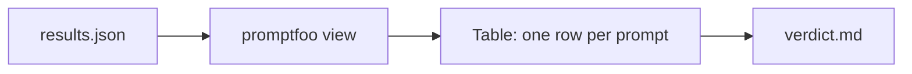
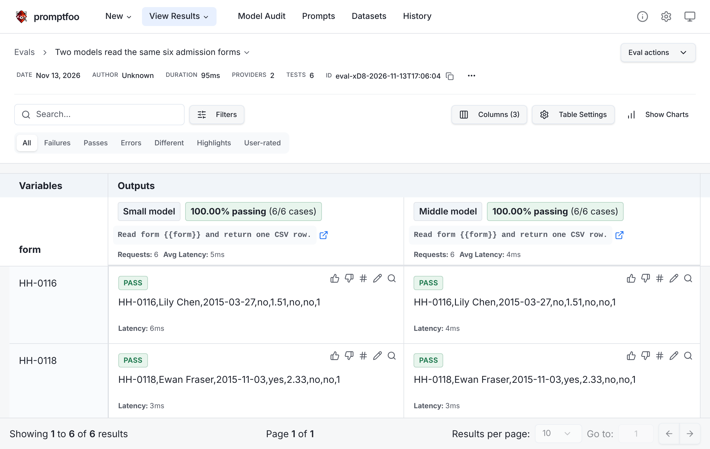

# View the comparison

## The problem

Two models read the same six admission forms. Their answers were recorded earlier, so you can look at them without a key or an account. promptfoo, a free tool, shows them side by side. For example, the two models disagree on the birth date for HH-0128, and the table shows it at once.



## Watch it done

Before, `verdict.md` has an empty Winner cell on every row. After, each row names a winner and says why, from something you can see in the table:

| Prompt  | Winner       | Why                                                                       |
| ------- | ------------ | ------------------------------------------------------------------------- |
| HH-0116 | Tie          | Both answers are the same row.                                            |
| HH-0122 | Middle model | The small model wrote yes for sibling_on_roll. The middle model wrote no. |



## Your turn

You work in this `problem/` folder. You need Node. Run `node --version` to see if you have it.

1. Import the recorded results.

```bash
npx promptfoo@0.125.1 import assignment/results.json
```

Expect: `has been successfully imported.`

2. Open the table.

```bash
npx promptfoo@0.125.1 view
```

Expect: your browser opens a page with a table. It has one row per prompt and one column per model. The left answer is the small model. The right answer is the middle model. If the page does not open, copy the address that `view` prints into your browser.

3. Open `verdict.md` in this folder. For each prompt, write Small model, Middle model or Tie under Winner. If both columns look the same, write Tie.
4. Under Why, point at something you can see in the two answers. Use `world/keys/applications.csv` if you want to check a field.
5. Run the check.

```bash
bun run verify view-the-comparison
```

Expect: `Done. All 3 rules pass.`

If `npx` is not found, install Node. Or run the same prompts in two browser tabs, one model in each. You get no table and no saved record, and you copy each answer by hand.

## Do it on your work

Write three or more prompts from your own work, such as three emails you need to answer. Put them through two models, in promptfoo or in two tabs. Pick a winner for each, and say why. A good answer has a reason you can point at, not a feeling. Step two does this on a task of your own.

## Done when

- `verdict.md` has a row for every prompt, HH-0116 to HH-0130.
- Every winner is Small model, Middle model or Tie.

The answers in the table were recorded earlier. Nothing in this step runs a model. The check only reads `verdict.md`, and confirms every prompt has a named winner. It does not judge whether you picked the right one. A pass in the table means the model gave an answer, not that the answer is right.

## Solution

The finished state is one filled-in `verdict.md`. See `solution/verdict.md` for a sample.
