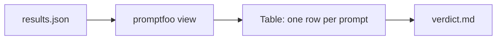
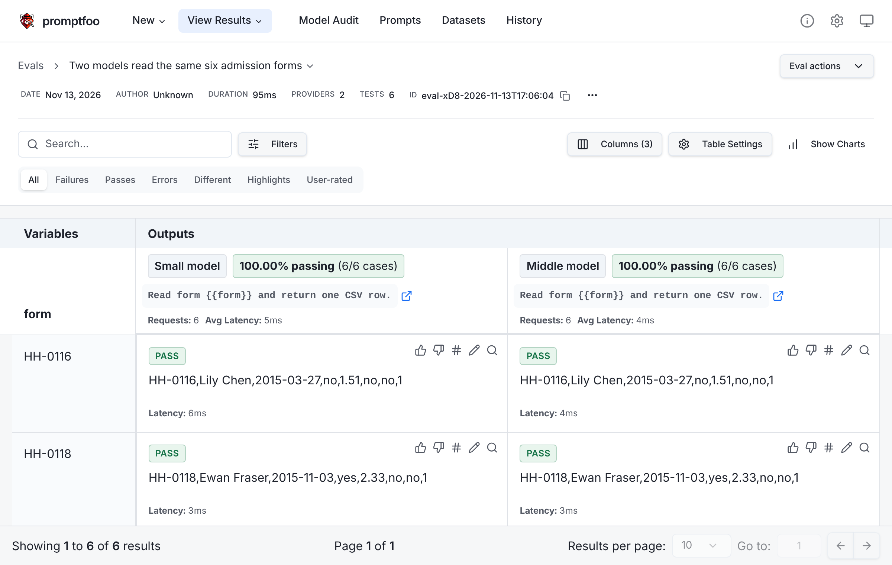

# View the comparison

## The problem

Two models read the same six admission forms. Their answers were recorded, so you can look at them without a key. promptfoo shows them side by side.

## Your challenge

1. Run `npx promptfoo@0.125.1 import assignment/results.json`. Then run `npx promptfoo@0.125.1 view`.
2. Read each row. The left answer is the small model. The right answer is the middle model.
3. Open `verdict.md` in this folder. For each prompt, write Small model, Middle model or Tie under Winner.
4. Under Why, point at something you can see in the two answers. Use `world/keys/applications.csv` if you want to check a field.
5. Run `bun run verify view-the-comparison`.

Note: PASS in the table only means the model gave an answer. It does not mean the answer is right.

## Done when

- `verdict.md` has a row for every prompt, HH-0116 to HH-0130.
- Every winner is Small model, Middle model or Tie.
- Each Why points at something visible in the answers.

## If you get stuck

- If `npx` is not found, install Node. Or use the browser option in the part page.
- If the page does not open, copy the address that `view` prints into your browser.
- If a row looks the same in both columns, the winner is Tie. For example, HH-0116 is the same in both.

## Words you will use

- **Prompt**: the text you send to a model. Here it is one form each.
- **Verdict**: your choice of winner, and why.
- **Eval**: one run of the same prompts through the models.
