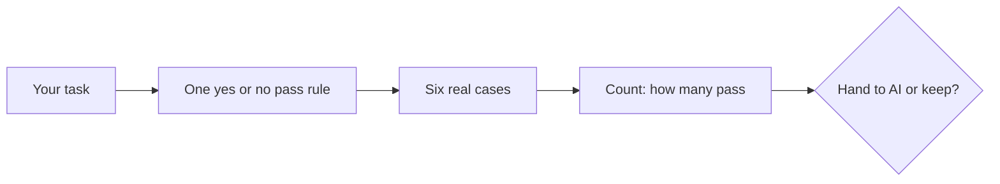

# Run your own task

## The problem

You have done the whole job on a school that is made up. Now do it once on your own work. Pick one small task,
write the rule for a good answer, and test the AI on six real cases. A test you ran yourself is worth more than any
tip from a course.



## Your challenge

Fill in `my-task.md` and `my-test-set.csv` in this folder. Use your own work, not Harbour Hill.

1. In `my-task.md`, under **Task**, name one task from your own work in a sentence.
2. Under **Pass rule**, write one yes or no question about a good answer.
3. In `my-test-set.csv`, add six or more real cases. Write the right answer first, then what the AI gave, then
   `yes` or `no`. For each `no`, say what went wrong.
4. Under **Result**, write how many passed, like `4 of 6 passed`. It must match the file.
5. Under **Hand to AI** and **Keep for a person**, say which part you would delegate and which you would not.
6. Under **What I tell people**, write the line you would add so others know an AI helped.

For example, a pass rule can be: `Does the reply give the right opening hours?`

## Done when

- `my-task.md` has all six parts filled in, and the pass rule is a yes or no question.
- `my-test-set.csv` has six or more different cases, each marked `yes` or `no`, and each `no` says why.
- **Result** matches the count in the file.
- Nothing in either file is about Harbour Hill School.

How this step is checked: the check reads only your two files. It checks the shape and that your evidence adds up.
A person decides if the task was a good one.

```bash
bun run verify run-your-own-task
```

Expect: `Done. All 9 rules pass.`

## If you get stuck

| What you see                           | Fix                                                       |
| -------------------------------------- | --------------------------------------------------------- |
| `FAIL Result matches the count...`     | Count the `yes` rows in the file, and write that number.  |
| `FAIL the pass rule is a yes or no...` | Start with Does, Is or Are, and end with a question mark. |
| `FAIL nothing in either file is...`    | Use your own work. Take the school out of the cases.      |

## Words you will use

- **Pass rule**: one yes or no question that says what a good answer is.
- **Delegate**: hand a task to someone else, here the AI.
- **Evidence**: the cases and counts that show your result, not a feeling.
