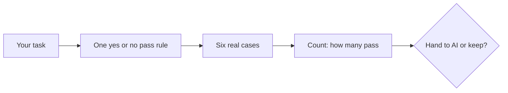

# Run your own task

## The problem

You have done the job on a made-up school. Now do it on your own work. Pick one small task, write a rule for a good answer, and test the AI on six real cases. For example, the rule can be: does the reply give the right opening hours?



## Watch it done

Before, `my-task.md` and `my-test-set.csv` hold only the starter text. After, the task has a pass rule, the CSV has six or more cases marked `yes` or `no`, and the Result line matches the count. See `../solution/` for a finished sample. In it, the Result is written as 4 of 6 passed and four rows say `yes`.

## Your turn

Use your own work, not Harbour Hill. You work in this `problem/` folder.

1. In `my-task.md`, under **Task**, name one task from your own work in a sentence.
2. Under **Pass rule**, write one yes or no question about a good answer. Start with Does, Is or Are, and end with a question mark.
3. In `my-test-set.csv`, add six or more different real cases. Write the right answer first, then what the AI gave, then `yes` or `no`. For each `no`, say in five or more words what went wrong.
4. Under **Result**, write how many passed, like 4 of 6 passed. Count the `yes` rows. It must match the file.
5. Under **Hand to AI** and **Keep for a person**, say which part you would delegate and which you would not. Use different words for each.
6. Under **What I tell people**, write the line you would add so others know an AI helped.
7. Run the check.

```bash
bun run verify run-your-own-task
```

Expect: `Done. All 9 rules pass.`

If you see `FAIL nothing in either file is`, take the school and its forms out and use your own work. If you see `FAIL Result matches the count`, count the `yes` rows again.

Now check your own folder, wherever you keep it, with the capstone check.

```bash
bun capstone/check.ts <your-folder>
```

Expect: a pass or fail line for each rule, run on your folder. The `verify` command above checks the `problem/` folder the same way.

## Do it on your work

This whole step is your work. Good looks like a task you really repeat, six cases you did not make up, and a count you can show. Go further: pick a second task and compare the two pass rates.

## Done when

- `my-task.md` has all six parts filled in, and the pass rule is a yes or no question.
- `my-test-set.csv` has six or more different cases, each marked `yes` or `no`, and each `no` says why.
- Result matches the count in the file.
- Nothing in either file is about Harbour Hill School.

The check reads only your two files. It checks the shape and that your counts add up. It does not run a model, and it cannot tell if your cases are real. A person decides if the task was a good one.

## Solution

The after state is `my-task.md` and `my-test-set.csv`. See `solution/` for a sample on a made-up task.
