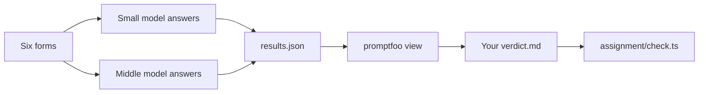

# Compare prompts with promptfoo

## The problem

In the last part you compared two models by hand. You scored each answer against the key, one field at a time. That works for six forms. It is slow for sixty.

Teams use a free tool called promptfoo for this job. It puts the same prompts through two models and shows the answers in one table. A table makes the differences easy to see. For example, the two models disagree on the birth date for HH-0128, and the table shows it at once. It also saves a record you can open again later.

Why it matters: a choice you can show beats a choice you remember. A saved table lets your boss check your work.

## What we teach

You open a table that was recorded earlier. It holds the answers of two models to the same six prompts. You pick a winner for each prompt and say why. You need no key and no account.



| Step                                                            | Minutes | What you hand in | What the check reads      |
| --------------------------------------------------------------- | ------- | ---------------- | ------------------------- |
| [view-the-comparison](01-view-the-comparison/problem/README.md) | 10      | `verdict.md`     | a winner for every prompt |

## Walkthrough

You need Node. It is a free tool that runs promptfoo. Run `node --version` to see if you have it.

```bash
npx promptfoo@0.125.1 import assignment/results.json
```

Expect: `has been successfully imported.`

```bash
npx promptfoo@0.125.1 view
```

Expect: your browser opens a page with a table. It has one row per prompt and one column per model.

```bash
bun run verify view-the-comparison
```

Expect: `Done. All 3 rules pass.` once `verdict.md` is filled in.

```bash
bun assignment/check.ts
```

Expect: `PASS  verdict.md names a winner for every prompt` and a new `assignment/result.json`.

## Options

Option: run the same prompts in two browser tabs, one model in each.

Choose when Node is not installed.

Trade-off: you get no table and no saved record. You must copy each answer by hand.

## Assignment

Optional in the live session. Expected as homework. The task, the Done-when line and the rubric are in [assignment/README.md](../../assignment/README.md).
