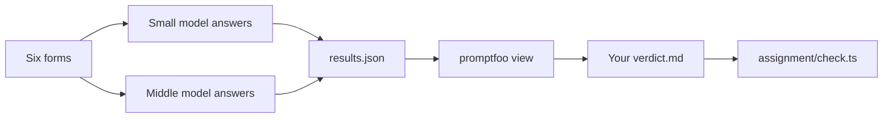

# Compare prompts with promptfoo

## After this part you can

Put the same prompts through two models, read the answers in one table, and pick a winner for each prompt with a reason.

## You leave with

A `verdict.md` for the recorded table, and a `my-task.md` with `my-test-set.csv` for a task of your own.

## The problem

In the last part you compared two models by hand. You scored each answer against the key, one field at a time. That works for six forms and is slow for sixty.

A free tool called promptfoo puts the same prompts through two models and shows the answers in one table. For example, the two models disagree on the birth date for HH-0128, and the table shows it at once.

promptfoo also saves a record you can open again later. A choice you can show beats a choice you remember.



## Steps

| Step                                                            | What you hand in                | What the check reads                                |
| --------------------------------------------------------------- | ------------------------------- | --------------------------------------------------- |
| [view-the-comparison](01-view-the-comparison/problem/README.md) | `verdict.md`                    | a winner for every prompt                           |
| [run-your-own-task](02-run-your-own-task/problem/README.md)     | `my-task.md`, `my-test-set.csv` | your own task, six cases, and a result that adds up |

You need Node, a free tool that runs promptfoo. Run `node --version` to see if you have it.

```bash
npx promptfoo@0.125.1 import assignment/results.json
```

Expect: `has been successfully imported.`

```bash
npx promptfoo@0.125.1 view
```

Expect: your browser opens a page with a table. It has one row per prompt and one column per model.

```bash
bun run verify view-the-comparison
```

Expect: `Done. All 3 rules pass.` once `verdict.md` is filled in.

```bash
bun run verify run-your-own-task
```

Expect: `Done. All 9 rules pass.` once `my-task.md` and `my-test-set.csv` are filled in.

```bash
bun assignment/check.ts
```

Expect: `PASS  verdict.md names a winner for every prompt` and a new `assignment/result.json`.

What the checks can and cannot do. The table is a recorded run. Nothing here calls a model.

The checks read your files. Every prompt must have a named winner. Your own task must have a pass rule and six cases, and your count must add up.

They do not judge whether your winners or your cases are good. A person does that.

The assignment is optional in the live session and expected as homework. Its task and rubric are in [assignment/README.md](../../assignment/README.md).

Without Node, run the same prompts in two browser tabs, one model in each. You get no table and no saved record, and you copy each answer by hand.

## Watch and read

| Kind  | Title                                               | Author                                               | Why                                                                    | Link                                                                 |
| ----- | --------------------------------------------------- | ---------------------------------------------------- | ---------------------------------------------------------------------- | -------------------------------------------------------------------- |
| read  | GPT vs Claude vs Gemini: Benchmark on Your Own Data | promptfoo team, promptfoo docs                       | The same compare-in-one-table method, with a config you can copy.      | https://www.promptfoo.dev/docs/guides/gpt-vs-claude-vs-gemini/       |
| read  | Your AI Product Needs Evals                         | Hamel Husain                                         | Why you test on your own cases, and how to start small.                | https://hamel.dev/blog/posts/evals/                                  |
| read  | Define your success criteria                        | Anthropic, Claude docs                               | How to say what a good answer is before you compare.                   | https://platform.claude.com/docs/en/test-and-evaluate/define-success |
| video | Why AI evals are the hottest new skill              | Lenny Rachitsky with Hamel Husain and Shreya Shankar | Two experts on looking at real answers and picking by evidence.        | https://www.youtube.com/watch?v=BsWxPI9UM4c                          |
| video | Prompting 101                                       | Anthropic                                            | See how a prompt is written and improved, so you can compare versions. | https://www.youtube.com/watch?v=FMWRfZ_VNdw                          |

## Project

Run one task from your own work through your own test set, in `run-your-own-task`. Write a pass rule, test six real cases, count the passes, and say what you would hand to the AI and what you would keep. For example: "4 of 6 passed. I hand over the first draft and keep every refund." You can then check your own folder with `bun capstone/check.ts <your-folder>`.
